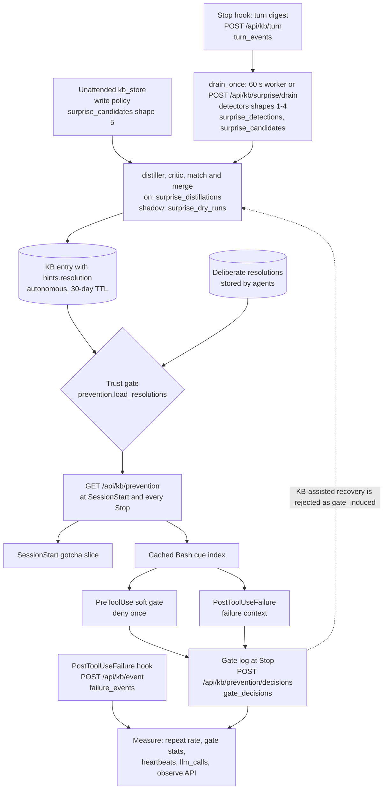
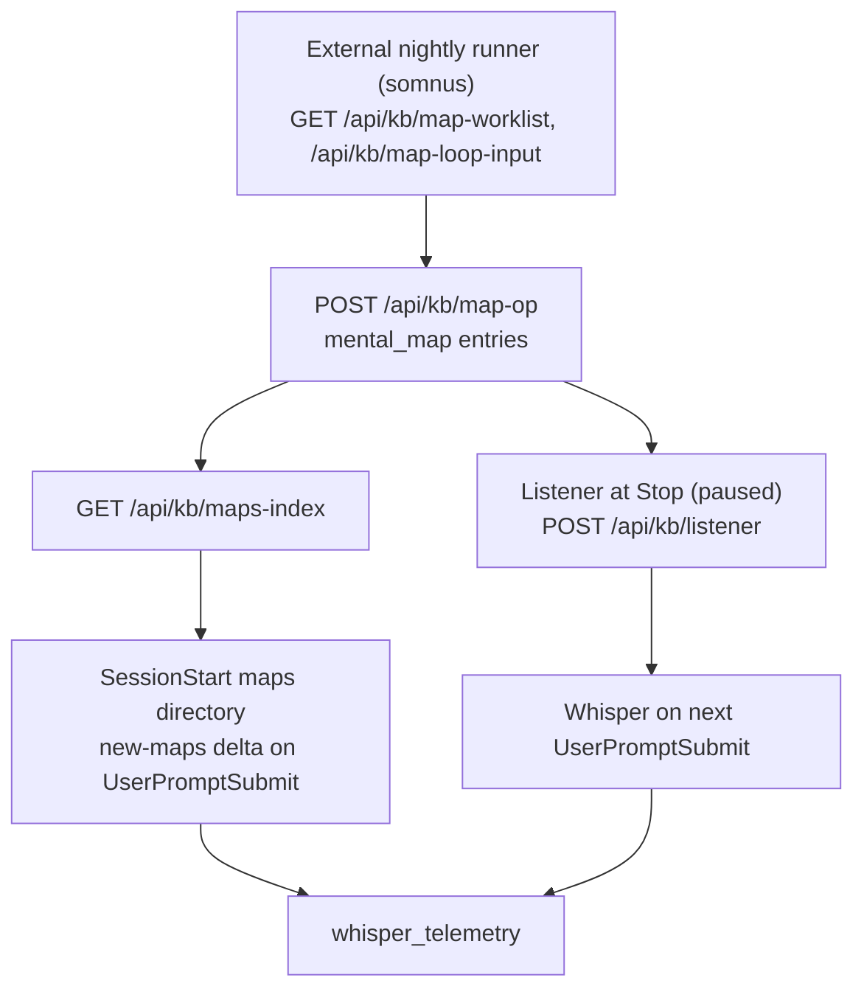

# Intelligent KB: the automation layer

This document covers every part of the KB that runs without an agent asking for it: the Claude Code hook, the service endpoints the hook and other harnesses call, the background capture worker, the unattended map loop's server-side contract, and the telemetry that says whether any of it works. [how_it_works.md](../how_it_works.md) covers the core KB (storage, hybrid search, the graph, kb_ask and kb_summarize, supersession, the near-duplicate guard, mental maps as entries, MCP over HTTP and the `llm_calls` ledger). Code is the source of truth; modules are named at package or directory level so a refactor inside a file does not falsify this page.

Maintenance rule: a change to a hook event, an automation endpoint or table, a switch or its default, or a delivery rule updates this file in the same change. Section 22 is the registry of automation switches.

Contents: [1 North star](#1-north-star-an-agent-that-learns-from-experience) · [2 The loop](#2-the-loop-on-one-screen) · [3 The hook](#3-the-hook-one-stdlib-process-seven-events) · [4 The lesson record](#4-the-lesson-record-hintsresolution-and-the-trust-model) · [5 Failure-cue index](#5-capture-a-the-failure-cue-index) · [6 Turn digests](#6-capture-b-turn-digests) · [7 Write policy](#7-capture-c-the-write-policy-unattended-agents-propose-never-write) · [8 Surprise detection](#8-distill-i-surprise-detection) · [9 Distiller and critic](#9-distill-ii-distiller-critic-match-and-expiry) · [10 Queued stores](#10-distill-iii-queued-stores-shape-5-w1-w9) · [11 Shadow mode](#11-shadow-mode-and-the-audit-endpoint) · [12 Prevention fetch](#12-deliver-i-get-apikbprevention-and-the-hooks-prevention-cache) · [13 Gotcha slice](#13-deliver-ii-the-sessionstart-gotcha-slice) · [14 Soft gate](#14-prevent-the-pretooluse-soft-gate) · [15 Failure context](#15-deliver-iii-failure-context) · [16 Orientation push](#16-orientation-push-maps-directory-and-tool-inventory) · [17 Listener](#17-the-anticipatory-listener-paused) · [18 Map maintenance](#18-map-maintenance-somnus-the-server-side-contract) · [19 Harness portability](#19-harness-portability-talos-and-the-wire-contracts) · [20 Measure](#20-measure-telling-whether-the-loop-works) · [21 Cost](#21-what-the-automation-costs) · [22 Switches](#22-production-state-and-switches) · [23 Tables](#23-data-the-loop-keeps-tables-and-retention) · [24 Evaluation](#24-how-it-is-evaluated) · [25 Known gaps](#25-known-gaps-and-open-questions)

## 1. North star: an agent that learns from experience

The automation layer exists to lower the cross-session repeat-mistake rate: a mistake one session made and recovered from should not recur in a later session, on any harness, model or machine that shares the KB. Whispers, maps, the gotcha slice and the soft gate are delivery details, and harness-native memory (Claude Code's MEMORY.md and its peers) is a channel to feed, not a competitor. The working plan lives in `proposals/experience-loop-roadmap.md`.

Five design rules are visible in the code:

- **No per-session budgets.** Lead sessions run for weeks, so limits are rates (the gate's per-turn and rolling-hour caps and its per-lesson re-arm window), and anything delivered once re-arms when the agent may have lost it: a SessionStart whose `source` is `compact`, `resume` or `clear` (the hook's `REARM_SOURCES`). The listener's whisper dedup is the one mechanism that still breaks this rule (section 17).
- **Silence beats a false positive.** The listener needs a majority of three votes, the gate admits only precise two-word Bash cues from trusted lessons, the critic fails closed, and a lesson seen once by a machine is hedged or withheld.
- **Trust is gated by provenance.** Every lesson records whether an agent stored it deliberately or a pipeline captured it autonomously, and whether tool output grounds it; machine writers cannot mint a deliberate lesson, and unattended surfaces can only propose entries (sections 4 and 7).
- **The hook never breaks the harness.** Every hook path exits 0, every network call has a short timeout and no retry, failures go to a local drop log, and PreToolUse makes no network call at all.
- **A feature earns its place in a controlled benchmark.** A memory or delivery mechanism is kept on the strength of an eval arm that isolates it, not design rationale (section 24).

The boundary with how_it_works.md: anything a hook, a worker or an unattended loop runs, or that exists to serve one, belongs here. The resolution format is shared: how_it_works.md describes it as a field on an entry, and section 4 here describes how the automation reads, writes and trusts it.

| Term | Meaning |
|---|---|
| resolution | A corrected belief stored on an ordinary KB entry under `hints.resolution`: a corrected fact, the wrong belief it replaces and optionally a cue. It is the unit every prevention channel delivers. |
| lesson | A resolution written autonomously by surprise capture (a `lesson_learned` entry with contributor `surprise-capture`). |
| cue | `{tool, target_class, args_prefix}` on a resolution: which tool call should trigger it. |
| `target_class` | The coarse class of a tool target: the program for Bash (plus its subcommand for a fixed set of CLIs, such as `git push`), or `ext:<suffix>` for file tools. |
| `args_prefix` | Tokens that must follow the class (flags dropped) for a Bash segment to match a cue; empty means every command of that class. |
| `cue_key` | A 16-hex hash identifying one kind of failure across sessions and machines, stored on `failure_events`. |
| slice | The SessionStart "Known gotchas" list (section 13). |
| gate | The PreToolUse soft gate: a rate-limited deny that an identical retry overrides (section 14). |
| failure context | The corrected fact printed next to a matching Bash failure (section 15). |
| whisper | The listener's one-line "Possibly relevant map" pointer on the next prompt (section 17). |
| digest | A turn digest: the per-turn summary the hook sends at Stop (section 6). |
| candidate | A `surprise_candidates` row: a detector hit or a queued store awaiting distillation. |
| shape 1 | A failed Bash command later followed by a different successful command of the same class in the same session (deterministic). |
| shape 2 | The human's next prompt corrects a factual claim from the assistant's previous turn (one model call). |
| shape 3 | Within one turn, the agent reaches a corrected understanding or root cause backed by a tool result (one model call). |
| shape 4 | A correction the harness itself reported (a `harness_correction` item from talos) plus the actions that resolved it (deterministic). |
| shape 5 | A create from a headless or autonomous surface, queued by the write policy for review. |
| surface | Where a write comes from: `interactive` (a person is in the loop), `headless` (a dispatched agent) or `autonomous` (an unattended loop). |
| session mode | `interactive` or `headless`, taken from `HEADLESS_BUILD_ENGINE` on the hook and clamped by the caller's surface on `/api/kb/turn`. |
| capture mode | `KB_SURPRISE_CAPTURE`: `off`, `shadow` (detect and dry-run, never write) or `on`. |
| machine principal | The one user identity the nightly map loop runs as, named in `app_config` (sections 4 and 18). |
| observed-once | An autonomous resolution seen in one session that is not first-sighting trusted: delivered hedged in the slice, never gated. |
| first-sighting trust | Shape 2, and shape 1 from an interactive session, are trusted at their first sighting: delivered unhedged in the slice, and gate-eligible when they carry a gateable cue, which only shape 1 can (so only interactive shape 1 gates at first sighting). Everything else autonomous waits for a second session. |
| re-arm | Clearing per-session delivery state so a lesson can be delivered again after compaction, resume or clear. |

## 2. The loop on one screen

The learning loop runs capture, distill, a trust gate, deliver, prevent and measure. Every box names its trigger, component, endpoint and table.



A second, smaller loop keeps orientation current. It is not part of the learning loop and its push channels have no positive evidence yet (section 24).



| Stage | Runs in | Writes | Read by |
|---|---|---|---|
| Failure capture | hook (PostToolUseFailure) then service request | `failure_events` | repeat-rate metric, gate stats, heartbeat, observe API |
| Digest capture | hook (Stop and SubagentStop, detached sender) then service request | `turn_events` | drain, critic evidence, candidates endpoint, observe API |
| Store queueing | service request (write routes, `/mcp`) | `surprise_candidates` (shape 5) | drain |
| Detection | service worker (`SurpriseCaptureWorker`) or `POST /api/kb/surprise/drain` | `surprise_detections`, `surprise_candidates` | distill, dry run, audit |
| Distillation | service worker, mode on | KB entries, `surprise_distillations` | prevention fetch, audit |
| Dry run | service worker, mode shadow | `surprise_dry_runs` | `GET /api/kb/surprise/candidates` |
| Prevention fetch | service request from the hook (SessionStart, Stop) | nothing | hook prevention cache |
| Slice | hook (SessionStart output) | nothing | the agent's context |
| Gate and failure context | hook (PreToolUse, PostToolUseFailure), cache only | local gate log, then `gate_decisions` at Stop | gate stats, distill (gate-induced check) |
| Map maintenance | external runner calling service endpoints | `mental_map` entries, `map_cluster_ledger`, `audit_events` | maps index, directory, listener |
| Directory and whispers | hook (SessionStart, UserPromptSubmit, Stop worker) | local whisper log, then `whisper_telemetry`; `listener_decisions` | efficacy analysis |
| Model spend | every recorder-equipped service client | `llm_calls` | observe API, cost queries (section 21) |

## 3. The hook: one stdlib process, seven events

`personal-kb-hook` (package `packages/personal-kb-hook`, entry point `personal_kb_hook/cli.py`) is one console script that Claude Code runs for seven events, listed in `cli.py` as `_SUPPORTED_EVENTS`. It reads one JSON object from stdin and branches on `hook_event_name`.

| Event | Modules | Network | May print |
|---|---|---|---|
| `PreToolUse` | `prevention.pre_tool` | none, cache only | the deny envelope |
| `PostToolUse` | `telemetry.mark_consumed`, only for `mcp__personal-kb__kb_get` and `mcp__team-kb__team_kb_get` | none | never |
| `PostToolUseFailure` | `prevention.failure_context`, then `events.post_failure` | one POST to `/api/kb/event` (1.5 s) | the failure-context envelope |
| `SessionStart` | `telemetry.orphan_sweep`, `prevention.orphan_sweep`, `prevention.session_start`, `tool_inventory.build_inventory`, then the directory pipeline (`resolver`, `roster`, `http_index`, `suppression`, `render`) | GET `/api/kb/prevention` (1.5 s); GET `/api/kb/maps-index` per KB (1.5 s each, 3.0 s wall); orphan flushes (at most 20 files, 5 s) | slice, directory, tool inventory |
| `UserPromptSubmit` | `prevention.new_turn`, the pending-whisper check, the directory pipeline | GET `/api/kb/maps-index` | new-maps delta, whisper |
| `Stop` | `telemetry.flush_session`, `prevention.stop`, `prevention.flush_gate_log`, `prevention.refresh`, `turn_digest.stop`, then the listener spawn | whisper POST (3 s), gate-log POSTs (3 s per chunk), GET `/api/kb/prevention` (1.5 s), detached turn sender (10 s), detached listener worker (30 s per KB) | never |
| `SubagentStop` | `turn_digest.subagent_stop` | one detached turn-sender POST to `/api/kb/turn` (10 s) | never |

**Never-raise contract.** Empty stdin, malformed JSON or an unsupported event produce no output and exit 0, and a top-level `try`/`except` in `cli.main` turns any unexpected exception into a silent exit 0. If SessionStart has already fetched a slice or built an inventory and then fails, it still emits them once.

**Output formats.** `--format text` (the default) prints bare text for SessionStart and UserPromptSubmit; `--format claude-json` wraps it as `{"hookSpecificOutput": {"hookEventName", "additionalContext"}}` (`render.render_claude_json`). The PreToolUse deny envelope and the PostToolUseFailure `additionalContext` envelope are always JSON, whatever `--format` says.

**Wiring.** The full settings snippet, including the `PostToolUse` entry that whisper-consumption telemetry needs and the root README omits:

```json
{
  "hooks": {
    "SessionStart": [
      { "matcher": "", "hooks": [{ "type": "command", "command": "personal-kb-hook --format=claude-json" }] }
    ],
    "UserPromptSubmit": [
      { "matcher": "", "hooks": [{ "type": "command", "command": "personal-kb-hook --format=claude-json" }] }
    ],
    "PreToolUse": [
      { "matcher": "Bash", "hooks": [{ "type": "command", "command": "personal-kb-hook --format=claude-json", "timeout": 5 }] }
    ],
    "PostToolUse": [
      { "matcher": "mcp__personal-kb__kb_get|mcp__team-kb__team_kb_get", "hooks": [{ "type": "command", "command": "personal-kb-hook --format=claude-json" }] }
    ],
    "PostToolUseFailure": [
      { "matcher": "", "hooks": [{ "type": "command", "command": "KB_FAILURE_CONTEXT=1 personal-kb-hook --format=claude-json", "timeout": 5 }] }
    ],
    "Stop": [
      { "matcher": "", "hooks": [{ "type": "command", "command": "personal-kb-hook --format=claude-json" }] }
    ],
    "SubagentStop": [
      { "matcher": "", "hooks": [{ "type": "command", "command": "personal-kb-hook --format=claude-json" }] }
    ]
  }
}
```

PreToolUse matches `Bash` only because only Bash cues are gated, and it must be synchronous to deny. PostToolUseFailure has no matcher so every failed tool reaches the failure-cue index, and it must be synchronous (no `async: true`): under async Claude Code delivers `additionalContext` on a later turn, detached from the failure. Claude Code does not fire PostToolUseFailure for validation rejections, permission denials or cancellations. SubagentStop fires once per subagent (and Workflow-tool agent) run and posts one digest of that run, never touching the parent session's turn counter.

**Service URL and key.** `defaults.resolve_url_key` returns `PERSONAL_KB_URL` (default `http://127.0.0.1:8765`) and `PERSONAL_KB_API_KEY`, with the sentinel `local-no-auth` only for a loopback URL. A remote URL without a key returns nothing, so every channel stays silent and posters log a `no_url_key` drop line. The hook never spawns the local daemon: with nothing listening it stays silent like every other error path. The prevention, event, turn-digest and whisper-telemetry calls all go to this one pair (the "personal" KB); only the maps index and the listener fan out across the roster.

**Project resolution.** `resolver.resolve_project(cwd)` walks from `cwd` through every parent; the first directory holding a `.kb_project` file wins, and the project is its first non-blank line not starting with `#`. A `.kb_project` with no usable line stops the walk and returns nothing (an outer file is not consulted); an unreadable file is skipped and the walk continues. The server falls back on its own: `kb_core.cues.resolve_cue_project(project, cwd)` (used by `/api/kb/prevention`, `/api/kb/event` and `/api/kb/turn`) takes a non-blank explicit project, else the `cwd` basename with any dispatch run-id suffix stripped, lowercased and `_` turned into `-`. A repo without `.kb_project` therefore still gets a project for the slice, gate and failure feed, but no maps directory, which needs the hook-side project.

**Roster.** `roster.load_roster` reads `<XDG_CONFIG_HOME or ~/.config>/personal_kb/kbs.json`, a JSON list of `{label, url, key_file}` objects; `url` must be http or https, the stripped contents of `key_file` become the bearer key (an inline key is not accepted), and invalid elements are dropped silently. A parseable list, including `[]`, is authoritative and never falls back. A missing, empty, non-JSON or non-list file falls back to one entry labelled `personal` built from `resolve_url_key`.

**Headless detection.** `telemetry.build_engine` returns `HEADLESS_BUILD_ENGINE` when set. It stamps `mode=headless` and `engine` on failure events, gate rows and digests, and it suppresses the listener unless `KB_LISTENER_HEADLESS=TRUE`, because a headless run never gets the next UserPromptSubmit that would deliver a whisper.

**Local files.** Everything the hook keeps lives flat under `~/.cache/personal_kb/`.

| File | Written by | Garbage collection |
|---|---|---|
| `injected-<session>.json` | maps-directory suppression | never swept |
| `listener-<session>.json` | listener worker, whisper delivery | never swept |
| `prevention-<session>.json` | prevention cache | unlinked by a SessionStart sweep once untouched for 7 days |
| `failure-context-<session>.json` | failure context | 7 days; deleted on re-arm |
| `gate-log-<session>.jsonl` (and `.flushing.jsonl`) | gate and failure-context decisions | deleted after a fully acknowledged flush at Stop; other sessions' logs untouched for an hour are flushed at SessionStart (at most 20 files, 5 s); deleted when over 256 KiB (drop line `gate_log_rotated`) |
| `whisper-log-<session>.jsonl` | roster and listener telemetry rows | flushed (and kept) at Stop; other sessions' logs are flushed and deleted at SessionStart (at most 20 files, 5 s) with no age check |
| `whisper-debug-<session>.log` | listener debug log | never swept, never rotated |
| `turn-state-<session>.json` | turn-digest counter | other sessions' files after 91 days |
| `turn-digest-log-<session>.jsonl` | turn-digest stop and send rows | 7 days |
| `event-drops.jsonl` | every poster's drop lines (ops `prevention_fetch`, `gate_flush`, `gate_log_rotated`, `failure_context`, `turn_digest`, and failure-event reasons) | deleted once over 256 KiB |
| `tool-inventory.jsonl` | tool-inventory decisions | rotated to `.1` at 1 MiB |

**Stdlib only, versioned with the repo.** The runtime package imports only the standard library, so it installs with zero third-party dependencies and can never break on a dependency conflict; `packages/personal-kb-hook/tests/test_hook_cli.py` parses every module's AST and fails on any other import. `scripts/stamp_hook_version.py`, run by `release.sh`, stamps the hook's `pyproject.toml` to the repo version. The failure-event body (`events.py`), the gate-decision rows (`prevention.py`) and the turn digest (`turn_digest.py`) carry that version as `hook_version` (read from `importlib.metadata`); whisper-telemetry rows (roster and listener) and the listener request body do not, and the server's `WhisperTelemetryRow` has no such field.

## 4. The lesson record: hints.resolution and the trust model

### Format

A resolution is a dict under `hints.resolution` on an ordinary KB entry. `kb_service/prevention.py` owns the format (its module docstring is the contract of record); `kb_service/resolution_hint.py` validates it on write.

| Field | Rule |
|---|---|
| `corrected_fact` | Required, non-blank string, at most 1000 characters. |
| `wrong_belief`, `evidence` | Optional strings. |
| `cue` | Optional `{tool, target_class, args_prefix}`; `tool` and `target_class` required when present; a Bash `target_class` must be a fixed point of `kb_core.cues.target_class`. |
| `provenance` | `{capture: deliberate or autonomous, grounding: observed or asserted, event_id}`; `observed` requires `event_id`. |
| `observed_sessions` | Integer at least 1 (a bool is rejected); default 1. |
| `scope` | `project` (default) or `global`. |

### Write-side validation

`resolution_hint.validate_and_stamp_resolution` runs on interactive `POST /api/kb/store` (create and update) and `POST /api/kb/store_batch` (in `routes/kb_write_routes.py`) before the map, supersession and near-duplicate guards, so a shape error is a 422 and never a 409; in a batch, one bad entry stores nothing. It is not the first check: on a create, the required-field check, the TTL parse and the secret scan run first, and a headless or autonomous surface is diverted to `queue_store` before stamping; on an update, `require_interactive`, the `change_reason` and `distinct_from` checks, the TTL parse, the secret scan and the 404 for an unknown entry run first. Inside the batch loop it is the first check on each entry. It also runs inside `write_policy.sanitize_store_hints` and the surprise distiller. It rejects unknown keys at any level, non-string fields, a blank or over-long `corrected_fact`, a cue missing `tool` or `target_class`, unknown capture, grounding or scope values, a bad `observed_sessions`, a non-normalized Bash class (`not_normalized`), and any resolution on a `mental_map` (the reader excludes maps).

Stamping: a non-machine writer defaults to `capture: deliberate`; grounding defaults to `asserted`; `observed` without `event_id` is `observed_needs_event_id`. The machine principal is always stamped `autonomous`, and a supplied `deliberate` is overridden and logged `resolution_capture_forced`. An autonomous, non-observed write cannot replace a stored deliberate resolution (`deliberate_protected`; a stored resolution without provenance counts as deliberate). An update that omits `resolution` leaves the stored one untouched. Every entry carrying a resolution logs one INFO `resolution-route` line.

**Machine principal.** `kb_service/attribution.py` `is_machine_principal(user)` compares the caller's email with the service-DB `app_config` key `machine_principal_email`, read on every call. `kb-service set-machine-principal --email <email>` sets it. An absent row means nobody is the machine principal, not even an admin, so every machine-only behaviour is inert.

### Reader filters

`prevention.load_resolutions` selects entries that are active, not superseded, not a `mental_map`, and unexpired (`expires_at` null or in the future, so an expired autonomous lesson drops out), whose hints mention `"resolution"`, newest first. It keeps entries whose `project_ref` equals the session's project plus `scope: global` entries from any project, with project-scoped entries sorted first. A malformed entry is skipped and counted (`skipped_malformed`), never raised.

### Trust

Two axes decide how far a resolution travels: who produced it (deliberate means an agent stored it because its session asked; autonomous means a pipeline did) and what grounds it (observed means tool output from a recorded event; asserted means only an agent's claim).

| | observed | asserted |
|---|---|---|
| deliberate | slice and gate | slice and gate |
| autonomous | slice; gate-eligible at first sighting for shape 2 and interactive shape 1, otherwise once `observed_sessions` reaches 2 | slice only, at any count |
| no provenance | slice only, labelled `unlabelled` | slice only, labelled `unlabelled` |

The gate also requires a Bash cue with a two-word class (`prevention.build_gate_index`, section 14). The distiller attaches a cue only to shape-1 lessons (`surprise_distill.build_resolution`) and a merge never adds one (a cue mismatch blocks the merge), so a shape-2 lesson never reaches the gate; for shape 2, first-sighting trust only changes slice delivery.

**Observed-once** is `capture == autonomous` and `observed_sessions < 2` and not first-sighting trusted. It reaches the slice with the hedge "observed once, unconfirmed" and never enters the gate index.

**First-sighting trust** (`FIRST_SIGHTING_SHAPES` = {1, 2}) reads `hints.surprise_capture.shape` and `hints.surprise_capture.mode`: shape 2 is trusted in any mode because the human's own correction is the evidence, and shape 1 only when `mode == interactive`, because a headless dispatch clone's transient state generalises badly. Headless, unknown or absent mode fails closed, and shapes 3, 4 and unknown shapes wait for a second sighting. A trusted first sighting is not observed-once, so the slice delivers it without the hedge, in the trusted tier ahead of corrections, outside the observed-once cap and even when `KB_DELIVER_OBSERVED_ONCE` is `FALSE`; the hedge is dropped because a hedged deny proved easy for an agent to ignore. Only an interactive shape-1 lesson with a Bash two-word cue also enters the gate index at first sighting.

**Recurrence promotion.** A merge from a second session raises `observed_sessions` to 2 (section 9), which makes an autonomous, observed Bash two-word cue gate-eligible.

**Labels.** `provenance_label` renders `unlabelled`, or `<capture>/<grounding>` with `?` for a missing half, plus `, observed once, unconfirmed` when observed-once; supersedes corrections are labelled `supersedes-edge`.

**`KB_DELIVER_OBSERVED_ONCE`** (service, read per request) withholds observed-once resolutions from both slice and index when set to the literal `FALSE`; any other value delivers them.

**Supersession does not carry resolutions.** A superseder must restate the resolution to keep it alive; a write that supersedes an entry holding a resolution without carrying one logs the WARNING `resolution_dropped_by_supersede`.

### Seeding

`packages/kb-service/scripts/seed_resolutions.py` drafts resolutions for existing procedure entries over HTTP (`PERSONAL_KB_URL`, `PERSONAL_KB_API_KEY`). It is a dry run unless `--apply`. Entries pass a regex prefilter, an LLM draft in chunks of 20 (purpose `seed_resolutions`, model `--model`, else `KB_ANTHROPIC_MODEL`), and an ordered guard ladder: `llm_unparseable`, `declined`, `empty_fact`, `bad_scope`, `not_normalized`, `not_two_word`, `example_mismatch`, `denylisted`, `class_collision`. `--pinned-file` writes `{entry_id: resolution}` verbatim with no LLM and must use a non-machine-principal key, or the server forces `autonomous` and the script reports `capture_forced` and exits 1. `--audit` is read-only and re-checks every stored resolution against the live validator and cue normalizer; run it after any normalizer change. Its client has no recorder, so it writes no `llm_calls` rows.

## 5. Capture A: the failure-cue index

The failure-cue index records every failed tool call under a stable `cue_key`, so the same mistake can be recognised across sessions, machines and harnesses. It is record-only: delivery happens through the gate index and failure context, never from this table.

**Hook poster.** `events.post_failure` builds one `post_tool` event: `event_id` `cc:<session_id>:<tool_use_id>`, harness `claude-code`, mode, engine, host, hook version, cwd, project (walk-up), ts, `tool_name`, `tool_input` reduced to top-level scalar values with strings cut to 2000 characters, the error cut to 4000, `is_error`, `is_interrupt` and `duration_ms`, plus `agent_id` and `agent_type` (null for main-session failures, the subagent's values on a subagent failure, where the payload carries them; main-session payloads carry neither key). It POSTs once with a 1.5 s timeout and no retry and needs `session_id`, `tool_use_id`, `tool_name` and an error. An undeliverable event appends a line to `event-drops.jsonl` with reason `missing_fields`, `no_url_key`, `timeout`, `urlerror`, `http_<code>` or `error`.

**`POST /api/kb/event`** (`kb_service/routes/event_routes.py`) answers 200 for every schema-valid body, with a `reason`: `unsupported-type` (types `session_start`, `pre_tool` and `turn_end` are accepted and ignored), `not-failure` (`is_error` false), `missing-fields` (blank tool name or error), `recorded`, `duplicate` (the `event_id` exists) or `write-failed` (a DB error, logged at WARNING, never a 5xx). For a mapped harness the tool name and argument names are canonicalized first (section 19). Two things this route does not do, unlike `/api/kb/turn`: it redacts no secrets, and it does not resolve the caller's surface, so the posted `mode` is stored as sent. Stored values are capped (`target` 500, `normalized_error` 200, `raw_error_excerpt` 2000).

**Normalizer: `kb_core/cues.py`.** One stdlib-only module with no I/O turns a raw failure into a cue (`build_cue`), and a vendored copy in the hook (`personal_kb_hook/cues_lite.py`) keeps the hook dependency-free; `tests/test_cue_drift_guard.py` asserts the two agree.

- `extract_target`: Bash `command`, `file_path` for Read, Edit, Write and MultiEdit, NotebookEdit `notebook_path`, Glob and Grep `pattern`; anything else, MCP tools included, gives an empty target.
- `target_class` for Bash takes the first segment that is not `cd` (split on `&&`, `||`, `;`, `|`), strips leading `VAR=value` assignments and `sudo` with its flags, and returns the program's basename. For a fixed program set (`git`, `uv`, `npm`, `pnpm`, `yarn`, `docker`, `kubectl`, `aws`, `gh`, `cargo`, `sam`, `cdk`, `terraform`, `agent-gtd`, `systemctl`, `pip`, `python`, `python3`, `pytest`, `make`) it appends the second token, unless that token starts with `-`, in which case the class stays one word. File tools give `ext:<suffix>` or `ext:none`.
- `bash_segments` returns `(target_class, args_after_class)` for every segment, splitting on newlines too and skipping `cd`. The failure row stores the first segment's class while the gate and shape 1 test every segment, which matters on compound commands (section 15).
- `normalize_error` strips ANSI codes, keeps an `Exit code N` header (Claude Code) or `exit N (1.2s)` header (talos, whose `--- stdout ---`/`--- stderr ---` markers it also drops) as `exit N`, keeps the first two lines containing an error keyword or else the last line, replaces volatile tokens (uuids, timestamps, `kb-N` ids, `toolu_` ids, hex runs, paths, line numbers, multi-digit numbers) with placeholders, lowercases, and caps at 200 characters. `error_rule` records which rule fired: `keyword`, `last_line`, `exit_only` or `empty`.
- `cue_key` is the first 16 hex characters of sha256 over `CUE_NORMALIZER_VERSION`, tool, `target_class`, normalized error and project. `host_class` (`darwin`, `linux`, `windows`, `unknown`, from the cwd shape) is stored for reporting only and kept out of the key, so the same mistake on two machines counts as a repeat.
- `CUE_NORMALIZER_VERSION = 2`. Any rule change must bump it, because the version is part of the key; a bump resets cue history in the repeat-rate metric.

**`failure_events`** (service DB) holds `event_id` (unique), `cue_key`, `normalizer_version`, `session_id`, `harness`, `mode`, `engine`, `host`, `hook_version`, `host_class`, `project`, `project_source`, `tool`, `target`, `target_class`, `normalized_error`, `error_rule`, `anomaly`, `raw_error_excerpt`, `is_interrupt`, `tool_use_id`, `agent_id`, `agent_type`, `ts` (UTC seconds, falling back to `received_ts`) and `received_ts`. `tool_use_id` is the hook's own id (null on rows from before it was persisted), and `agent_id`/`agent_type` are null on main-session failures and on every row from a pre-subagent hook. `anomaly` flags `empty_error` or `empty_bash_target`, and the row is stored anyway. Failures join turn digests by `tool_use_id`, scoped by `agent_id` (a subagent's failure is posted under the parent `session_id` but its tool call lives only in the subagent's own transcript): a failure's `ts` is stamped mid-turn and cannot be used as the join key.

**`GET /api/kb/event/heartbeat`** (`hours` 1..720, default 24) groups the window's rows by (harness, mode, host) with counts, anomalies, the latest timestamp and hook version, plus the process's route-outcome counters. It counts failures only, so a quiet machine and a dead pipeline look the same: cross-check the machine's `event-drops.jsonl` before concluding nothing failed.

**Offline backfill.** `packages/kb-service/scripts/failure_cue_baseline.py` reads Claude Code transcript files (no DB, no network), treats `tool_result` blocks with `is_error: true` as failures, excludes the kinds the live hook never sees (`<tool_use_error>`, permission refusals, user cancellations and interrupts), dedupes by `tool_use_id`, normalizes with the same `build_cue`, and reports a repeat rate with under- and over-collapse warnings.

## 6. Capture B: turn digests

A turn digest summarises one agent turn so the server can detect corrections after the fact without the hook spending any model calls.

### Hook digest sender

At every Stop the hook calls `turn_digest.stop` directly after `prevention.refresh` and before the listener gate, so the listener switches do not matter. The only gate is the `surprise_capture` value cached from the last `/api/kb/prevention` fetch: the hook sends only in `shadow` or `on`.

- **Counter.** `turn-state-<session>.json` holds `next_turn_index` and `last_uuid` and advances on every Stop in any mode. `event_id` is `<session_id>:<turn_index>`.
- **Window.** `read_turn` reads the last 8 MiB of the transcript (`TURN_TAIL_BYTES`) and walks newest to oldest until it meets the previous digest's `last_uuid` or a human prompt: a `user` record that is not sidechain, meta or a compact summary, whose `origin.kind` is `human` when present, with no `tool_result` blocks and text not starting with a slash-command echo, `local-command` or `[Request interrupted by user`.
- **Items**, in file order: `assistant_text` (2000 characters), `tool_call` (`tool_use_id`, `tool`, `target` cut to 500, `target_class` computed by `cues_lite`), `tool_result` (`tool_use_id`, `is_error`, an excerpt of up to 1500 characters, else a 746-character head, a `[...]` marker and a 747-character tail). Sidechain records are skipped. `final_message` comes only from the Stop payload's `last_assistant_message` (4000 characters), because the transcript can lag.
- **Body.** 16 keys: `event_id`, `session_id`, `harness` (`claude-code`), `mode`, `engine`, `host`, `hook_version`, `project` (from the cached prevention response), `turn_index`, `ts`, `user_prompt`, `items`, `final_message`, `truncated`, `agent_id` and `agent_type` (both null on the Stop path). At most 200 items are kept, newest first; over 64 KiB (`TURN_DIGEST_MAX_BYTES = 65536`) items are dropped oldest-first with `truncated` true, and a digest that does not fit even with no items is dropped as `too_large`. Text is sent raw; the server redacts.
- **Send.** The body goes to a temp file and a detached `python -m personal_kb_hook.turn_sender` POSTs it once with a 10 s timeout and no retry, then deletes the file, so Stop never waits on the network.
- **SubagentStop digests.** At every SubagentStop the hook posts ONE digest of the subagent's own run (`turn_digest.subagent_stop`), gated by exactly the same cached `surprise_capture` switches as the Stop digest and doing none of the other Stop work. Its `event_id` is `<session_id>:agent:<agent_id>` (the parent's session id, the subagent's agent id), and `agent_id`/`agent_type` carry the subagent's values; `agent_type` is null when the payload omits it. `turn_index` is the parent session's current counter, read only: SubagentStop never advances it and never touches the last-uuid boundary, so the parent's turn-state file is byte-identical before and after. The item window is the agent transcript (`agent_transcript_path`, tail-bounded like `read_turn`) with EVERY record kept — the sidechain skip does not apply, because all of a subagent transcript's records are sidechain — and `user_prompt` is the text of the first user record that yields non-empty text (a `tool_result`-only or blank record is skipped and the scan continues; the `human_prompt_text` filters do not apply). `final_message` is the payload's `last_assistant_message`. Drop reasons are the `subagent_` vocabulary: `subagent_no_url_key`, `subagent_missing_fields`, `subagent_transcript_unreadable`, `subagent_too_large`, `subagent_spawn_failed` and `subagent_error`; the reused turn sender appends the same one `send` row per POST, distinguishable by the `:agent:` event_id. A digest's `ts` is when the turn or subagent run ENDED, so it is not a join key for failures, which are stamped mid-turn (join by `tool_use_id`, scoped by `agent_id`). The drain never distills a subagent digest: it claims the row and skips it, and it is excluded from the session context the detectors see.
- **Drops** go to `event-drops.jsonl` with op `turn_digest`: `no_url_key`, `transcript_unreadable`, `too_large`, `spawn_failed`, `error`, `state_write_failed`, `body_unreadable`, `http_<code>`, `timeout`, `urlerror`, or `rejected_<server reason>` on the Stop path, and `subagent_no_url_key`, `subagent_missing_fields`, `subagent_transcript_unreadable`, `subagent_too_large`, `subagent_spawn_failed` and `subagent_error` on the SubagentStop path.
- **Local log.** `turn-digest-log-<session>.jsonl` (never sent) records one `stop` row per Stop and one `send` row per send — the `send` row covers subagent POSTs too — for reconciling against the server heartbeat.
- **State GC.** Other sessions' turn-state files are removed after 91 days, longer than the server's 90-day retention, so a recreated counter cannot reuse a retained `event_id`.

### Ingest: POST /api/kb/turn

`kb_service/routes/turn_routes.py` checks, in order:

1. 422 for a schema-invalid body (`TurnDigestRequest`: `event_id` must equal `<session_id>:<turn_index>` when `agent_id` is absent, and `<session_id>:agent:<agent_id>` when it is present; caps of 4000 for `user_prompt` and `final_message`, 2000 for assistant and reasoning text, 500 for a tool target, 1500 for a tool-result excerpt and a correction detail, at most 200 items; an unknown item kind or trigger fails the whole digest; unknown keys are dropped). A 422 logs `turn_event reason=invalid` with error locations and types only, never input.
2. The mode clamp: `write_policy.resolve_write_context` resolves the caller's surface, and a headless or autonomous caller posting `mode: interactive` is stored as `headless` and logged `turn_event mode_clamped`, because mode decides shape-1 first-sighting gate trust.
3. 413 when the raw body exceeds 65536 bytes, even with capture off.
4. The capture switch: `off` answers `capture-off` and touches nothing.

In `shadow` or `on` it normalizes tool names for mapped harnesses, redacts, flags anomalies and inserts with `ON CONFLICT (event_id) DO NOTHING`. Reasons: `recorded`, `duplicate`, `duplicate-mismatch` (same `event_id`, different content; logged, stored row unchanged), `capture-off`, `redaction-unavailable` (nothing stored) or `write-failed`, all at HTTP 200. Any authenticated key may post; the route is not surface-gated. Each request logs one INFO `turn_event` line with counts, never content.

### Talos-only items

Two item kinds come only from harnesses that record them (talos today); the Claude Code hook never emits them.

- `reasoning` `{kind, text, truncated}` carries agent reasoning. The shape-3 prompt renders it, but it never admits a turn and never grounds evidence.
- `harness_correction` `{kind, trigger, detail, resolved_by, resolved}` reports a correction the harness itself made. `trigger` is `gate_red` (the project gate failed; detail is its output), `claim_rejected` (the harness rejected a done claim; detail is the claim), `no_change` (the agent tried to finish with no change; detail is the harness's message) or `nudge` (the harness prompted the agent to continue or finish; detail is the nudge). `resolved_by` lists up to 200 tool_use_ids between the trigger and the next green gate or accepted finish, and `resolved` says whether that happened before the run ended. The KB never branches on `trigger`.
- Sender rules: (a) emit each correction exactly once, in the digest holding its last resolving tool call, or in the run's final digest with `resolved` false; (b) `resolved_by` names only tool calls posted in that digest or an earlier one of the same session; (c) when fitting the 200-item and 64 KiB budget, drop reasoning items first, then tool items no correction names, and never a correction or a tool call it names; (d) a forward or dropped reference is recorded permanently as `ungrounded`/`resolved_by_unmatched`.

### Secret redaction

`turn_digest.redact_turn_digest` runs `kb_core.ingest.safety.redact_secrets` over `user_prompt`, `final_message`, and per item `assistant_text.text`, `reasoning.text`, `tool_call.target`, `tool_result.excerpt` and `harness_correction.detail`; `packages/kb-service/tests/test_turn_digest.py::test_str_field_partition_drift_guard` fails when a new string field is added without being classified. It runs six detect-secrets plugins (keyword, private key, basic auth, AWS key, GitHub token, JWT) per line and, where no plugin hits, four regex fallbacks (secret assignment, Anthropic API key, bearer token, private-key end line). A hit replaces the whole line with `[REDACTED:<type>]`, and a private key replaces the whole field with `[REDACTED:Private Key]`. Redacted values are cut back to their caps, which can cut a marker or a field tail (logged `retruncated`). Without detect-secrets installed nothing is stored (`redaction-unavailable`). Known misses: secrets with no key name or token shape, such as `curl -u user:pass` or an opaque value alone on a line. The distiller rejects any lesson whose wrong belief or verdict contains a redaction marker (section 9).

### Storage and heartbeat

`turn_events` (service DB) holds `event_id`, `session_id`, `harness`, `mode`, `engine`, `host`, `hook_version`, `project`, `turn_index`, `ts`, `user_prompt`, `items` (JSON), `final_message`, `truncated`, `redactions`, `anomaly`, `capture_mode`, `processed_at`, `agent_id`, `agent_type` and `received_ts`. `agent_id`/`agent_type` are set only on SubagentStop digests (rows from old hooks carry both null) and a subagent digest shares its parent's `session_id` and `turn_index`. `anomaly` is a comma-joined subset of `empty_bash_target_class`, `orphan_tool_result` (only when not truncated), `empty_turn` and `empty_tool_target` (mapped harnesses only). `processed_at` null is the single pending marker, and `mark_turn_digests_processed` is its only writer: a single-id call returns 1 only to the caller that flipped the row, so it doubles as an atomic claim — the drain uses it to claim-and-skip subagent digests (counted `agent_skipped` in the drain's INFO line, never distilled, never detector context). `capture_mode` is informational; the mode at processing time decides. Rows older than 90 days (`TURN_EVENTS_RETENTION_DAYS`) are deleted by each shadow or on drain pass.

`GET /api/kb/turn/heartbeat` returns counts by (harness, mode, host) with truncated, redacted, anomaly and empty-project counts, the pending count and oldest pending `received_ts`, `sessions_with_gaps`, the route outcomes and `unmapped_tools`. Reconcile it against the machines' `turn-digest-log-*` files: a `send` row with no server row is a lost digest.

## 7. Capture C: the write policy (unattended agents propose, never write)

`kb_service/write_policy.py` decides what a write may do from the surface it comes from, so an unattended agent can propose knowledge without writing to the KB directly. Trust order: `interactive` (2), `headless` (1), `autonomous` (0).

**Resolving the surface.** `resolve_write_context(request, user)` takes the API key's `api_keys.surface` when set; otherwise `interactive` for a password (JWT) login; otherwise `default_surface()`, which reads `KB_WRITE_POLICY_DEFAULT_SURFACE` on every call (unset or blank means `interactive`, a known value is used as is, anything else means `headless` with a one-time `bad_default_surface` WARNING). The `X-KB-Mode` header can only lower the surface (unknown values mean `headless`). `X-KB-Harness` and `X-KB-Engine` are reduced to `[A-Za-z0-9._:/-]`, at most 64 characters, and recorded. `source` records why: `key`, `jwt`, `default` or `header`. The stdio client sends `User-Agent: personal-kb/<version>` and, when `HEADLESS_BUILD_ENGINE` is set, `X-KB-Engine` plus `X-KB-Harness: claude-code`; it never sends `X-KB-Mode`.

**Every write route is classified.** `WRITE_ROUTE_CLASSES` maps every `/api/kb` write route to `policed` (calls `resolve_write_context`: store, store_batch, deactivate, reactivate, bulk_update and the three ingest routes), `admin_only`, `machine_principal_only` (map-op, map delete), `pipeline` (surprise drain) or `no_entry_write` (reads, feedback, listener, event, turn, gate decisions, whisper telemetry, map-lint, cluster ledger, pointer candidates). `test_write_policy.py::test_write_route_classification` walks the app's routes and fails when a write route is missing or a `policed` handler does not call the resolver, so a new route cannot bypass the policy silently.

**What a non-interactive surface may do.**

- A create runs the usual required-field, TTL and secret checks, then `queue_store` (or `queue_store_batch`).
- Update, deactivate and reactivate always call `require_interactive` first and answer 403. `bulk_update` and the three ingest routes (`ingest/text`, `ingest/url`, `ingest/file` in `routes/ingest_routes.py`) call it only when the request is not a dry run, so a dry run from a headless or autonomous surface is allowed (ingest is refused because re-ingesting a known source deactivates its old entries, which a dry run never does).
- An API key minted from a non-interactive surface inherits that surface (`op=mint_key reason=inherited_surface`), so a headless key cannot mint itself a default-trusted key.
- Refusals are 403s whose detail starts `write policy: `, from `REJECTION_TEMPLATES` (`update`, `deactivate`, `reactivate`, `bulk_update`, `ingest`, `supersedes`, `distinct_from`, `mental_map`, `no_project`; batch details are prefixed `entry <i>: `). Both clients render them as `Error: <detail>`.

**Queueing.** `queue_store` reads the capture mode once and refuses `mental_map` entries, a blank `project_ref`, any `supersedes` (request field or a hint other than none) and any `distinct_from`. `sanitize_store_hints` drops `surprise_capture`, `write_policy`, `supersedes` and `distinct_from` hints and forces a resolution to `{capture: autonomous, grounding: asserted}`, `observed_sessions` 1 and `scope` project before validation, so a routed resolution is observed-once and can never gate. A post-condition tripwire logs `write-policy tripwire=resolution_not_sanitized` and raises without inserting. The batch path validates every entry before inserting all rows in one transaction, so one bad entry rejects the batch.

**The shape-5 candidate.** Each queued entry becomes one `surprise_candidates` row: shape 5 (`STORE_CANDIDATE_SHAPE`), `session_id` `key:<api_key_id>` or `user:<user_id>`, the project, `turn_event_ids` `[]`, `detector_model` `write-policy`, status `pending` in capture mode `on` and `shadow` otherwise (including `off`). `detector_output` holds `kind` (`store`), `op`, `batch_index`, `surface`, `source`, `harness`, `engine`, `api_key_id`, `user_id`, `auth_method`, `contributor`, `team`, `capture_mode` and `request` (the agent's titles, details, type, project, source context, confidence, tags, sanitized hints, sensitivity and ttl). The response is `{status: queued, candidate_id, surface, capture_mode}` (a batch returns `requested` and `candidate_ids`), rendered by both clients as "Queued as candidate N", with "for review" in mode on and "recorded for audit only" otherwise. Nothing deduplicates at insert: a retried store makes a second candidate, which the near-duplicate check marks covered once the first is written. Queued rows created while capture is off are never distilled, even after capture turns on; they can be dry-run only if shadow starts within 24 hours.

**`/mcp` tool visibility.** `kb_service/mcp_server/surface_filter.py` `SurfaceToolFilterMiddleware` resolves the same surface per `/mcp` request. Headless and autonomous callers see only the allow-list `NON_INTERACTIVE_TOOL_BASES` (search, get, ask, summarize, preflight, explore, map_eligibility, list_projects, list_contributors, list_teams, store, store_batch, feedback, each with the instance prefix), and a call to any other tool fails with `write policy: <tool> is not available from the <surface> surface; use an interactive session.` before it runs. It is an allow-list, so a new tool stays hidden from unattended callers until it is added. A request with no principal is treated as headless; startup listing outside a request is unfiltered.

**Key administration.** `kb-service list-keys [--email E]` prints each key's id, email, name, hash prefix, surface (`default` for NULL) and creation time. `kb-service set-key-surface --key-id ID --surface interactive|headless|autonomous|default` is the only setter (`default` writes NULL, which follows `KB_WRITE_POLICY_DEFAULT_SURFACE`).

**Logs.** Every policy decision logs exactly one INFO `write-policy op=... outcome=allowed|queued|rejected surface=... source=...` line with no entry text. Startup logs `write-policy started default_surface= capture_mode= worker= keys=interactive:n,headless:n,autonomous:n,unset:n`, and warns `write-policy queue_unattended` with `reason=capture_off` or `reason=worker_not_started` when stores can be queued but nothing will drain them.

## 8. Distill I: surprise detection

**The capture switch.** `KB_SURPRISE_CAPTURE` takes `off`, `shadow` or `on`; anything else means `off`. `turn_digest.surprise_capture_mode()` reads it on every call, so `/api/kb/turn`, `drain_once`, `queue_store` and `/api/kb/prevention` follow a flip at their next request. `SurpriseCaptureWorker` reads it once at startup, so turning capture on from `off` needs a service restart for the background worker. The value reaches the hook as the top-level `surprise_capture` field of `/api/kb/prevention`, so a live session starts or stops sending digests at its next Stop. `off` records nothing and spends nothing; `shadow` stores digests, detects and dry-runs the distiller and critic without writing; `on` also writes lessons. Candidates created in shadow keep status `shadow` and are never replayed when the mode flips to on.

**The drain.** `kb_service/surprise_worker.py` `drain_once(pool, kb)`:

1. Reads the mode; `off` returns zeros with no DB access, model call or log line.
2. Prunes `turn_events` and `llm_calls` older than 90 days (`TURN_EVENTS_RETENTION_DAYS = 90`, `LLM_CALLS_RETENTION_DAYS = 90`). Only the `llm_calls` prune is guarded (a failure logs `llm_calls prune failed` and the pass continues). A `turn_events` prune failure propagates out of `drain_once` and ends the pass before any digest is processed: the background worker logs `surprise_worker drain failed` and retries at its next poll, and `POST /api/kb/surprise/drain` answers 500.
3. Reads the per-shape confidence floors once.
4. Lists pending digests (`processed_at` null) in (session, turn_index) order and loads each session's stored digests once.
5. For each digest runs detection, then claims it with a single-id `mark_turn_digests_processed`; a claim that does not return 1 logs `tripwire=double_detect` and writes nothing. It then inserts the candidate and detection rows in one transaction; a failure after the claim logs ERROR `lost_after_claim` and propagates, and the digest stays claimed. No model call runs while a connection is held.
6. In mode `on`, distills every `pending` candidate in id order, queued shape-5 stores included (section 9). In mode `shadow`, dry-runs every recent shadow candidate (section 11).

Each pass logs one INFO `surprise_drain` heartbeat with the mode, detector version, floors, pruned count, digests, candidates per shape, model calls, outcome counters, the digest flags (`truncated`, `out_of_order`, `turn_gaps`), timings and prompt sizes, distill and dry-run inputs, and shape-4 counters.

**Shape 1** (`detector_model` `rule:shape1`, confidence 1.0, no model call). Within each digest a Bash call pairs with the result sharing its `tool_use_id`; calls without a result are dropped. Each command is classified per segment with `kb_core.cues.bash_segments`, and the classes in `SHAPE1_IGNORED_CLASSES` (cat, ls, head, tail, grep, rg, find, which, test, echo, pwd, stat, wc, file) are skipped because read-only probes failing is not a lesson. A failed call is pending under every one of its classes (the most recent failure wins); a later success in the current digest pairs with the first pending failure sharing a class and pops it. A pair whose commands are identical is dropped. Output: wrong belief = failed command (500), corrected fact = successful command (500), evidence = the failure's excerpt (1500), plus `cue_target_class` when the shared class differs from the failed command's own class. `turn_event_ids` are the failure's digest and the current one. Several pairs in one digest give one candidate and one detection row each.

**Shape 2** (one call, purpose `surprise_detector_shape2`). Skipped as `no_prev` (turn 0), `turn_gap` (previous digest missing), `no_user_prompt` or `no_prev_text`. The prompt shows the previous turn's assistant text and final message and the human's next message, and asks whether the human says a factual claim or assumption was wrong (not a new request, a preference or style change, an approval or a follow-up question). A verdict becomes a candidate only if its confidence meets the shape-2 floor and its evidence excerpt appears verbatim (after whitespace collapse and casefold) in the human message. `turn_event_ids` are the previous and current digests.

**Shape 3** (one call, purpose `surprise_detector_shape3`). Skipped as `no_tool_result` or `no_text_after_result` (an empty final message and no assistant text after the first tool result). The prompt renders the turn's items one per line (`[assistant]`, `[tool_call <tool>]`, `[tool_result error=...]`, `[reasoning]`) plus an `[assistant final]` line unless it repeats the last assistant text, and asks whether the agent reached a corrected understanding or root cause, supported by a tool result, that contradicts what it, the code, a comment, a doc, a config or the environment had indicated; routine progress and ordinary fixes do not count. Evidence must be copied verbatim from a tool-result excerpt of the current digest, never from assistant text or reasoning. Rows also record `shape3_scope` (`text_after_result` or `final_message_only`), `final_rendered`, `reasoning_items`, `reasoning_chars`, `reasoning_after_result`, and `evidence_in_reasoning` on an ungrounded verdict. The prompt is the whole rendered turn, the largest input of any capture call.

**Shape 4** (`rule:shape4`, confidence 1.0, no model call). One record per `harness_correction` item in the current digest, so Claude Code digests get no shape-4 rows. `resolved_by` ids are matched against tool calls in the session's digests up to this turn, in ascending turn order, first occurrence winning. The first matching rule decides: not resolved is `not_applicable`/`unresolved`; an empty detail is `not_applicable`/`empty_detail`; no ids is `not_applicable`/`no_resolving_actions`; no id matched is `ungrounded`/`resolved_by_unmatched` (also a `surprise_drain shape4_unmatched` WARNING with a `turn_gap` flag); otherwise a candidate whose wrong belief and evidence are the detail (500 and 1500) and whose corrected fact is `<tool> <target>` of each matched call joined by `; `. Details record `trigger`, `resolved`, `resolved_by_count`, `resolved_by_matched`, `resolved_by_errored`, `last_resolving_error` and `resolved_by_tools`. Shapes 2 and 3 never see these items.

**Detector client.** `get_detector_llm` builds an Anthropic client per model from `KB_SURPRISE_DETECTOR_MODEL` (default `claude-sonnet-5-5`, `SURPRISE_DETECTOR_DEFAULT_MODEL`), with the `llm_calls` recorder attached. It ignores `KB_QUERY_PROVIDER`, so a Bedrock or Ollama deployment still sends detection to the Anthropic API. It is None only if the Anthropic SDK cannot be imported (shapes 2 and 3 then record `no_llm`). With no `ANTHROPIC_API_KEY` the client exists but every call returns nothing, so shapes 2 and 3 record `llm_error` and the digest is still claimed and never retried.

**Confidence floors**, read once per pass: `KB_SURPRISE_MIN_CONFIDENCE_SHAPE2` or `_SHAPE3` wins, then the global `KB_SURPRISE_MIN_CONFIDENCE`, then the defaults (0.5 for shape 2, 0.7 for shape 3). A non-numeric or out-of-range value logs `bad_min_confidence` and falls through. A higher floor cuts candidates and downstream distiller calls, not detector calls.

**Tables.** `surprise_candidates` holds id, shape (1-5), session, project, `turn_event_ids`, `detector_model`, `detector_output` (JSON), status and `entry_id`. Statuses: `pending` (awaiting distillation, mode on), `shadow` (terminal, never written), `rejected` (any no-write outcome), `written` (new entry), `merged` (folded into an existing entry, including `same_session`). `surprise_detections` is the decision log, negatives included: one row per shape per claimed digest (shape 1: one per pair when pairs fire, else one `no_surprise` row; shape 4: one per item, none without items), with `event_id`, shape, mode, `outcome` (`candidate`, `not_applicable`, `no_llm`, `llm_error`, `unparseable`, `invalid_fields`, `no_surprise`, `low_confidence`, `ungrounded`), reason, model, `detector_version` (`SURPRISE_DETECTOR_VERSION = 4`, bumped on any prompt, parser, grounding, threshold or rule change), confidence, `candidate_id`, `details` (counters, `min_confidence`, digest flags), a 2000-character raw response excerpt, prompt and response sizes and latency.

**Triggering a pass.** `POST /api/kb/surprise/drain` (any authenticated key, no body) runs one pass under the in-process lock `app.state.surprise_drain_lock` and returns `digests_processed`, `candidates`, `entries_written` and `entries_merged`. `SurpriseCaptureWorker` runs `drain_once` every 60 s (`SURPRISE_WORKER_POLL_SECONDS`) under the same lock and logs and continues on a failed cycle. It starts at lifespan only when the mode is shadow or on and `KB_DATABASE_URL` points at a Postgres kb-core backend; on SQLite (local mode, kb-bench) only the route drains. Digests are processed one at a time, so a backlog drains at model latency.

**Audit SQL** (Postgres):

```sql
-- Turns that reasoning-admission would add to shape 3
SELECT count(*) FROM surprise_detections
WHERE shape = 3 AND reason = 'no_text_after_result' AND detector_version >= 3
  AND (details::jsonb ->> 'reasoning_after_result') = 'true';

-- Shape-4 outcomes per trigger
SELECT details::jsonb ->> 'trigger' AS trigger, outcome, reason, count(*)
FROM surprise_detections WHERE shape = 4 GROUP BY 1, 2, 3;

-- Shape-4 dry runs per trigger
SELECT c.detector_output::jsonb ->> 'trigger' AS trigger, r.would_outcome, count(*)
FROM surprise_candidates c JOIN surprise_dry_runs r ON r.candidate_id = c.id
WHERE c.shape = 4 GROUP BY 1, 2;

-- Should be 0: talos reported resolved while its last resolving action failed
SELECT count(*) FROM surprise_detections
WHERE shape = 4 AND outcome = 'candidate'
  AND (details::jsonb ->> 'last_resolving_error') = 'true';
```

## 9. Distill II: distiller, critic, match and expiry

In mode `on`, `surprise_worker.distill_candidates` turns each pending shape 1-4 candidate into a lesson, a merge, or a recorded rejection. It runs sequentially in id order through these steps. The code calls the sequence S0-S13 but names only two steps individually: S0, the claim pre-check (`distill_candidates`), and S12, the match decision (`_decide_match`); the other rows below are unnumbered in the code.

| Order | Check | Outcome when it fires |
|---|---|---|
| 1 (S0) | status is no longer `pending` | skipped, `tripwire=double_distill`, no row |
| 2 | blank project | `no_project` |
| 3 | wrong belief contains `[REDACTED:` | `redacted` (a redacted secret can never become a recurrence key) |
| 4 | evidence contains `KB soft gate (deny once` | `gate_induced` (the gate's own denies never manufacture a lesson) |
| 5 | shape-1 wrong belief equals the target of a `failure_context` or `failure_context_repeat` gate row in the same session | `gate_induced`, reason `failure_context` (a recovery the KB handed the agent never corroborates its own lesson) |
| 6 | shape 1 | build the cue |
| 7 | exact match among the project's resolutions | straight to the match step, no model call |
| 8 | distiller or critic client missing | stays `pending` (`no_llm`, retried next pass) |
| 9 | distiller call | `llm_error`, `unparseable`, `not_durable`, `invalid_fields` |
| 10 | redaction marker in the verdict; secret scan of titles and details unless `KB_SKIP_SAFETY` | `redacted`, `secret_detected` |
| 11 | resolution validation (`is_machine=True`) | `invalid_resolution` |
| 12 | critic call | `not_durable` with reason `critic: ...`, `llm_error`, `unparseable` |
| 13 | cosine near-duplicate lookup | match step, or a new entry |
| 14 (S12) | match step | `merged`, `same_session`, `covered` |
| 15 | write | `written` |

**The distiller.** One call (purpose `surprise_distiller`) per candidate that needs one. The system block `SURPRISE_DISTILLER_SYSTEM` holds every static instruction: the role, the input line, one line per shape (1-4), `DISTILLER_INSTRUCTIONS`, `LESSON_CLASS_PROMPT` and the schema line. The user prompt carries only the candidate: shape, project, wrong belief, corrected fact and evidence. The reply is JSON `{durable, why, short_title, long_title, corrected_fact, lesson, lesson_class}`. Rejects: `llm_error` (no reply; reason `exception` or `none`), `unparseable`, `not_durable` (anything but `durable: true`; reason is `why`, up to 200 characters) and `invalid_fields` (a blank title, fact or lesson, or a `lesson_class` outside `LESSON_CLASSES`). Accepted fields are cut to 80, 200, 500 and 2000 characters. The instructions require `durable` false for typos, transient errors, the session's own in-progress changes, transient checkout or environment state, a retry that only narrowed scope, temporary states and task-specific priorities, and require the corrected fact at exactly the evidence's scope using only facts in the evidence. `SURPRISE_DISTILLER_VERSION = 9` (4 tightened durability, 5 added the scope rule, 6 added lesson classes, 9 moved every static instruction into one system block with a 1-hour cache breakpoint), and it is bumped on any change to the prompt, parser, builders, match rules or step order. `get_distiller_llm` reads `KB_SURPRISE_DISTILL_MODEL` (default `claude-sonnet-5-5`) on every call.

**Lesson classes** (`agent_harness`, `project_architecture`, `superseded_prior`, `product_guidance`, `homelab_infra`, `quality_gates`, `project_tooling`, `none`) are metadata only: recorded as `hints.surprise_capture.lesson_class` and the tag `lesson-class:<class>`, kept from the first write on merges, so precision can be measured per class. `GET /api/kb/surprise/candidates` reports a class only from a shadow dry run's payload (section 11); for a lesson written in mode `on`, read it from the entry's tag or hint. Nothing filters or routes on them.

**The shape-1 cue rule** (`surprise_distill.shape1_cue`). The class is the detector's `cue_target_class` or the failed command's own class, and must be a fixed point of `kb_core.cues.target_class`. Take the first segment of each command whose class equals the cue class, and let F and S be their arguments after the class with flags dropped. `args_prefix` is the first k tokens of F for the smallest k from 1 to min(3, len(F)) where F and S differ in their first k tokens. When either segment is missing, F is empty, or no such k exists (the first three arguments agree, or F is a prefix of S, so any prefix would also match the fix), there is no cue and the lesson reaches the slice only. Example: `git push origin main` corrected by `git push origin HEAD:refs/for/main` gives class `git push` with prefix `origin main`, which never matches the corrected command or another push. Cues this precise exist because the first production night wrote cues as broad as a whole command family (`uv run`, `git checkout`), and one denied an unrelated command within minutes. Shapes 2-4 never carry a cue.

**The critic.** One call (purpose `surprise_critic`) after a durable verdict has passed the redaction, secret and resolution checks, and before the near-duplicate lookup, so it also gates a cosine merge. `get_critic_llm` reads `KB_SURPRISE_CRITIC_MODEL` (default `claude-sonnet-5-5`) per call. The prompt (`surprise_distill.build_critic_prompt`) carries the shape, the project and the evidence: the detector's three fields for every shape, plus the human's correction text (up to 2000 characters) for shape 2 and up to 20 tool-result excerpts (2000 each) for shape 3, both read from the stored digest of the candidate's last turn event and omitted once that digest is pruned. Then the drafted title, corrected fact and lesson, `CRITIC_INSTRUCTIONS` and the schema `{supported, scope_ok, durable, misleading, reason}`. The draft proceeds only when supported, scope_ok and durable are true and misleading is false, and a hedged user claim ("I think", "maybe", "not sure", a question) counts as unsupported unless a tool result confirms it. It fails closed: an exception or empty reply is `llm_error` (`critic: exception` or `critic: none`) and an unparseable reply or missing boolean is `unparseable`. A rejection is recorded as `not_durable` with reason `critic: <reason>` in mode on (the outcome CHECK has no critic outcome) and as `critic_rejected` in a dry run. `SURPRISE_CRITIC_VERSION = 2` and is recorded as `critic_version` beside the parsed critic object in the verdict JSON.

**Matching.** Two routes find an existing lesson:

- Exact match (`surprise_distill.find_exact_match`, row 7) over the project's resolutions, observed-once included: the same wrong belief after whitespace collapse and casefold, and an equal cue. The first in load order wins, and no model is called because a merge writes no new text; shape-4 candidates with an identical detail merge this way.
- Cosine match (row 13): `kb.find_near_duplicates` at `KB_NEAR_DUPLICATE_FLOOR` (0.88) over same-project entries of any type except `mental_map`; the top hit is the match. With no embedder or a failed search it fails open and writes a new entry.

The match step (`_decide_match`) never writes, outcome `covered`, when the entry is gone (`missing`), has no resolution (`no_resolution`, so a cosine hit on a plain entry suppresses the lesson), is not autonomous (`deliberate`), is global (`global`) or has a different cue (`cue_mismatch`). If the candidate's session already appears in `hints.surprise_capture.sessions` or the session part of `provenance.event_id`, the outcome is `same_session` with no write. Otherwise it is `merged`: one `kb.update` (enrich off, `updated_by` `surprise-capture`, `change_reason` starting `surprise_capture: merged candidate <id> from session <sid>; observed_sessions a->b`) raises `observed_sessions` by one, leaves every other resolution key unchanged, appends the session, candidate id and event id to `hints.surprise_capture`, and renews the expiry. The summary line counts `promoted` merges (1 to 2 on a Bash two-word cue).

**A new entry** (row 15, `written`) is a `lesson_learned` written through `kb.store` with enrich off (no enrichment model call): contributor `surprise-capture`, confidence 0.7, tags `surprise-capture`, `shape-<n>` and `lesson-class:<class>`, source context `surprise_capture candidate <id> shape <n> session <sid>`, details = lesson, wrong belief, corrected fact, evidence and a captured-autonomously line, and `expires_at` now plus the TTL. `hints.resolution` is `{corrected_fact, wrong_belief, evidence, provenance {capture: autonomous, grounding: observed, event_id: the candidate's last turn event}, observed_sessions: 1, scope: project}`, plus a cue for shape 1 only (autonomous/asserted when there is no turn event). `hints.surprise_capture` holds `shape`, `lesson_class`, `mode` (from the last turn event's `turn_events.mode`; omitted when unknown), `sessions` and `candidate_ids` (newest 100) and `event_ids` (newest 20).

**Expiry.** A new lesson expires after `SURPRISE_LESSON_TTL_DAYS = 30` days (`KB_SURPRISE_LESSON_TTL_DAYS` overrides it with an integer from 1 to 3650; anything else logs `bad_lesson_ttl` and uses 30). Each merge from a new session resets the expiry to now plus the TTL, and the merge that brings `observed_sessions` to 3 (`PERMANENT_OBSERVED_SESSIONS`) clears it with `clear_expiry=True`, so the lesson becomes permanent. The TTL exists because about a third of the harmful lessons in a replay were true when captured and false after a later change. Expired entries leave the slice, the gate index, default search and `kb_preflight`. Because the loaders skip inactive, superseded and expired entries, a deactivated or expired lesson no longer blocks recapture: the next recurrence writes a fresh entry at `observed_sessions` 1. Deliberate entries never merge and never get an expiry from this code.

**Outcomes and persistence.** The 14 outcomes are `written`, `merged`, `same_session`, `covered`, `not_durable`, `redacted`, `gate_induced`, `llm_error`, `unparseable`, `invalid_fields`, `invalid_resolution`, `secret_detected`, `no_project` and `kb_error` (any other exception; the batch continues). Candidate status becomes `written`, `merged` (for merged and same_session) or `rejected`. Each decision is one `surprise_distillations` row: candidate, session, project, shape, outcome, reason, new and matched entry ids, `match_kind`, `similarity`, near-duplicate status and floor, `cue_target_class`, `observed_sessions_before` and `_after`, the parsed `verdict` JSON, distiller model and version, a redacted raw excerpt, sizes and latency. Each decision logs one INFO `surprise_distill decision` line (no lesson text) and each call one `surprise_distill summary` line. Persistence assumes one writer per service DB (the drain lock); the status update is conditional on `pending`, and the KB write and the candidate update are not atomic across the two databases.

## 10. Distill III: queued stores (shape 5, W1-W9)

Shape-5 candidates go through `surprise_worker._decide_store_one`, shared by mode on and the shadow dry run. It never merges: any same-project near duplicate means the store is already covered.

1. W1: the request must be a dict with a non-blank short title, long title and details, else `invalid_fields`/`request`.
2. W2: a blank project is `no_project`.
3. W3: a missing distiller or critic client is a `no_llm` skip; the candidate stays and is retried.
4. W4: one store-distiller call (purpose `store_distiller`, `STORE_DISTILLER_SYSTEM`, details capped at 8000 characters by `STORE_PROMPT_DETAILS_MAX`); the reply is `{durable, why, short_title, long_title, lesson_class}` with titles cut to 80 and 200.
5. W5: a redaction marker in the titles or details is `redacted`.
6. W6: a secret scan of the titles and final details unless `KB_SKIP_SAFETY` (`secret_detected`).
7. W7: the store critic (purpose `store_critic`, `STORE_CRITIC_SYSTEM`, the same four-boolean verdict), failing closed.
8. W8: `kb.find_near_duplicates` at `KB_NEAR_DUPLICATE_FLOOR`; any same-project hit is `covered`/`near_duplicate` with match kind `cosine`. An unavailable check proceeds.
9. W9: write (or `would_write` in shadow).

**The written entry** (`store_distill.build_store_kwargs`) keeps the agent's own entry type and details and appends a provenance paragraph ("Queued by the write policy from a <surface> surface (candidate <id>) and written after the distiller and critic reviewed it"). Source context is `write_policy candidate <id> (<surface> surface)`; confidence is min(requested or 0.9, 0.7); tags are the agent's plus `write-policy`, `surface:<surface>` and `lesson-class:<class>`; hints are the sanitized hints plus `write_policy` `{candidate_id, surface, harness, engine, api_key_id, op, lesson_class}`; contributor, team and sensitivity are the requester's; enrich is off. It expires at the lesson TTL or the agent's shorter `ttl`. These entries carry neither the `surprise-capture` tag nor `hints.surprise_capture`.

**Renewal.** An entry without a resolution has no renewal path: nothing re-observes a store. One carrying a sanitized (autonomous) resolution can be matched and merged by a later turn candidate, which renews it like any lesson and makes it permanent at the third session.

**Versions.** `STORE_DISTILLER_VERSION = 1` and `STORE_CRITIC_VERSION = 1` number the shape-5 family separately from the turn distiller, so filter by shape before comparing `distiller_version`. `test_store_distill.py` pins sha256 tripwires over the inputs shared with `surprise_distill.py` (`LESSON_CLASSES`, `LESSON_CLASS_PROMPT`, the shape-5 description, `CRITIC_SCHEMA_LINE`, `parse_critic_response`), so changing them forces a store-version bump. When a pass saw shape-5 input, `surprise_distill store_summary` and `surprise_dry_run store_summary` log per-family counts.

## 11. Shadow mode and the audit endpoint

Shadow exists so that turning capture on is decided by auditing what the pipeline would write on real traffic, since benchmark scenarios contain only the intended trap and only real traffic shows the noise.

**One decision function.** `surprise_worker._decide_one` runs every check, the distiller, the critic and the match logic, reads the KB and never writes, leaving `would_write` or `would_merge` with the prepared `kb.store` or `kb.update` arguments. Mode on then calls `_execute_decision` to perform the write; shadow records the decision. Both modes share the function, so they cannot drift.

**Dry runs.** In shadow, `drain_once` selects every `shadow` candidate created in the last 24 hours (`DRY_RUN_LOOKBACK_SECONDS`, so a first deploy does not replay an unbounded backlog through the model) that has no dry run, shape 5 included, and calls `dry_run_candidates`. Each decision is one `surprise_dry_runs` row (id, `candidate_id` unique, session, project, shape, distiller model and version, `would_outcome`, reason, `payload` JSON, `mode`, `created_at`); nothing is written to the KB, no `surprise_distillations` row is made and the candidate stays `shadow`. `would_outcome` is the on-path outcome with `written` renamed `would_write` and `merged` renamed `would_merge`, plus `critic_rejected`. `payload` holds `short_title`, `long_title`, `corrected_fact`, `lesson`, `lesson_class`, `wrong_belief`, `cue`, `matched_entry_id`, `similarity`, `critic_version` and `critic`. A second dry run of one candidate is refused with `tripwire=double_dry_run`, backed by the unique index. A candidate needing a missing model gets no row and is retried; an exception is recorded as `kb_error`. Shadow spends the same distiller and critic calls as mode on.

**`GET /api/kb/surprise/candidates`** (any authenticated key) returns candidates newest first. Parameters: `since` (default 24 hours ago; naive timestamps are UTC), `status`, `shape` (1-5), `project`, `limit` (default 200, max 1000). Each row carries id, shape, status, session, project, created time, detector model and output, `turn_event_ids`, `entry_id`, `lesson_class` (copied from the dry run's `payload.lesson_class`, so null whenever the candidate has no `surprise_dry_runs` row, which includes every candidate distilled in mode `on`), `mode` and `host` (from the last turn event, null once pruned) and `dry_run` `{would_outcome, reason, payload, distiller_model, distiller_version}` or null. It never returns raw digest items, but a queued store's `detector_output` carries the full requested entry.

**How shadow decided the re-enable.** After the first night's incident capture went back to shadow, and `proposals/experience-loop-roadmap.md` records the window from 04:00Z to 13:58Z on 2026-10-10: 12 candidates, 9 correctly rejected (in-progress lint and type errors, transient checkout state, one critic rejection of an embellished user claim) and 3 would-write lessons, all correct. Capture went back on at 13:58Z with the existing trust rules, an Opus critic and the 30-day expiry.

## 12. Deliver I: GET /api/kb/prevention and the hook's prevention cache

One fetch per session tells a harness whether the gate is on, what its limits are, which cues to match, what slice to inject and whether to send digests. No model is called anywhere on this path.

**Request.** Query parameters `project`, `cwd`, `session_id` and `harness`, all optional; `harness` falls back to the `X-KB-Harness` header (sanitized). The Claude Code hook sends project, cwd and session id and no harness. The project is `resolve_cue_project(project, cwd)`.

**Response** (`PreventionResponse`, `kb_service/routes/prevention_routes.py`):

- `project`.
- `gate`: `enabled`, `shadow`, `max_denies` (legacy, fixed at 1000 so hooks that predate the rate limits are not capped at 2 denies), `max_denies_per_turn`, `max_denies_per_hour`, `rearm_hours`.
- `index`: the gate cues (section 14), built only when the gate is enabled, or the caller is a mapped harness and the project is not in `KB_SOFT_GATE_DISABLED_PROJECTS`; otherwise `[]`.
- `slice` and `slice_text` (section 13).
- `diagnostics`: `resolutions_total`, `skipped_malformed`, `skipped_observed_once`, `index_truncated`, `slice_truncated`, `index_excluded_observed_once`.
- `surprise_capture`: the current `KB_SURPRISE_CAPTURE`, present on every path.
- `tool_map`: native-to-canonical tool names for the harness, `{}` for Claude Code, unknown or absent harnesses.

With no resolvable project it returns gate settings and an empty index and slice. Any exception is logged (`prevention_fetch failed`) and answered with an inert 200 (gate disabled, shadow true, empty index and slice), which a client cannot tell from "nothing to deliver"; it never answers 5xx. Each fetch logs one INFO `prevention_fetch` line with ids and counts, and two WARNING tripwires fire if an observed-once or an autonomous non-observed resolution ever reaches the index (`observed_once_in_index`, `asserted_in_index`).

**Hook side.** `prevention._fetch` makes one GET with a 1.5 s timeout, no retry, to the personal KB only. `_apply_fetch` rewrites `prevention-<session>.json` atomically with the project, the gate (`enabled` only when literally true; `shadow` unless literally false, so a missing field means shadow; each limit an integer 1..1000, else the defaults 1, 6 and 24, so an older server is tolerated), the index, `surprise_capture` (`off` if unknown) and `fetched_ts`. It preserves the per-session state: `deny_state`, `deny_timestamps`, `turn_denies`, `pending_retry` and the PreToolUse health counters. A failed fetch keeps the old cache and logs a `prevention_fetch` drop line; with no cache at all, the gate and failure context are inert.

**Arming and refresh.** The hook fetches at SessionStart (after re-arming on `compact`, `resume` or `clear`) and again at every Stop (`prevention.refresh`), recording an `armed` decision row each time with the index and slice sizes. Fetching at Stop is what lets a server-side switch flip reach a live, weeks-long session at its next Stop instead of its next restart. The prevention cache is garbage-collected after 7 days untouched.

## 13. Deliver II: the SessionStart gotcha slice

The slice puts known traps in context before the first action: a short list of corrected facts, each replacing an earlier wrong belief. It is context only and is never written to CLAUDE.md or any memory file.

**Building it** (`prevention.build_slice`): first the trusted resolutions (not observed-once), then up to 20 supersedes corrections from `load_corrections` (for each superseded entry in the project whose superseder is active and unexpired: corrected fact = the superseder's short title, wrong belief = the superseded entry's short title, label `supersedes-edge`), then at most 5 observed-once resolutions (`SLICE_OBSERVED_ONCE_CAP`), deduplicated by entry id and capped at 20 (`SLICE_CAP = 20`). `diagnostics.slice_truncated` counts the observed-once overflow plus items beyond 20.

**Rendering** (`prevention.render_slice`): the header `Known gotchas for <project> from the KB (each replaces an earlier wrong belief):` then one line per item, `- <corrected_fact> (was: <wrong_belief>) [<provenance_label>; <entry_id>]`, with each field cut to 300 characters. Lines are dropped from the end until the text fits 4000 characters, and those drops are not counted in `slice_truncated`. An empty slice renders as nothing.

**Delivery.** `prevention.session_start` returns `slice_text` and the CLI places it first in the single SessionStart output, ahead of the maps directory. It is delivered on every SessionStart source, including resume and compact, and the maps suppression scratch does not apply to it. `KB_GOTCHA_SLICE` set to `0`, `false`, `no` or `off` on the hook withholds the text while the gate index is still fetched and armed; that is the `gate_only` evaluation arm.

## 14. Prevent: the PreToolUse soft gate

Before a Bash call runs, the hook checks it against the cached cue index and on a match denies it once, with the corrected fact as the reason; retrying the identical call goes through. The gate exists because a delivered slice lesson did not stop a habitual command in a two-session trial, while a deny did.

**Index admission** (`prevention.build_gate_index` on the service): a resolution enters only with `cue.tool == "Bash"`, a two-word `target_class` (such as `git push`) and `_gate_trusted` (section 4). The index is capped at 200 (`INDEX_CAP = 200`; overflow counted in `index_truncated`), and observed-once resolutions are excluded (counted in `index_excluded_observed_once` when they would otherwise qualify). File-tool classes, one-word classes and cue-less resolutions reach the slice only. Cue breadth is the author's job: a cue without `args_prefix` denies every command of its class.

**Matching** (`prevention._find_match` in the hook). `cues_lite.bash_segments` splits the command on `&&`, `||`, `;`, `|` and newlines, skips `cd` and unclassifiable segments, and tests each segment's `(target_class, args)` in order against the index in index order; the first hit wins, so `git commit -qam x && git push github main` matches a `git push` cue. A cue matches when tool and class are equal and, if `args_prefix` is set, the segment's arguments (flags dropped) start with its tokens. Blind spots: `git -C /repo push origin main` classifies as plain `git` and `python -m pytest` as `python`, because a flag in second position keeps the class one word, so two-word cues never match them.

**The deny.** Unless shadow, the hook prints `{"hookSpecificOutput": {"hookEventName": "PreToolUse", "permissionDecision": "deny", "permissionDecisionReason": ...}}`. The reason is `KB soft gate (deny once): <corrected_fact> Earlier wrong belief: <wrong_belief> [<provenance_label>; <resolution_id>]`, truncated so the whole reason fits 1000 characters and always ending with ` If you still intend this exact call, retry it unchanged and it will be allowed.` The prefix `KB soft gate (deny once` is load-bearing: the distiller rejects any candidate whose evidence contains it (`GATE_DENY_MARKER`), so the gate cannot teach itself. An observed-once prefix exists in the hook but never fires, because the service never indexes observed-once cues.

**Retry and override.** After a real deny the cache holds `pending_retry`. The next call of the same tool records a `retry` row with `retry_changed_command` (whether the target changed). An identical retry also marks the lesson overridden (an `overridden` row) and is allowed, because the lesson is inside its re-arm window. A retry still pending at Stop is recorded as abandoned (`retry_changed_command` null).

**Rate limits and re-arm, not budgets.** Per-lesson state is `deny_state` `{resolution_id: {last_deny_ts, overridden}}`.

- A lesson denied less than `rearm_hours` ago records `skipped_already_denied` (reason `overridden` or `not_rearmed`) and does not deny.
- Otherwise the call is checked against the caps: `turn_denies >= max_denies_per_turn` records `skipped_cap` reason `per_turn`; at least `max_denies_per_hour` denies in the last 60 minutes (a bounded `deny_timestamps` list) records `skipped_cap` reason `per_hour`.
- The per-turn counter resets on UserPromptSubmit (`prevention.new_turn`), on Stop and on re-arm, so a one-prompt headless run can deny at most `max_denies_per_turn` times.
- A SessionStart with source `compact`, `resume` or `clear` empties `deny_state`, zeroes the turn counter, deletes the failure-context state and records one `rearmed` row, because the agent may no longer have the earlier deny in context; `startup` does not re-arm.

**Switches**, read by the service on every prevention fetch and failing closed: `KB_SOFT_GATE_ENABLED` must be literally `TRUE` (any case); `KB_SOFT_GATE_SHADOW` stays shadow unless literally `FALSE`; `KB_SOFT_GATE_DISABLED_PROJECTS` is a comma-separated, case-insensitive list that forces the gate off and withholds the index (even from mapped harnesses) while the slice is still served. The limits are `KB_SOFT_GATE_MAX_DENIES_PER_TURN` (1), `KB_SOFT_GATE_MAX_DENIES_PER_HOUR` (6) and `KB_SOFT_GATE_REARM_HOURS` (24), each an integer 1..1000 with a WARNING and the default otherwise. In shadow the hook consumes the same per-lesson state and limits but records `would_deny` and prints nothing, so would-deny counts equal what live denies would have been. Every switch reaches a live session at its next Stop.

**Decision log.** PreToolUse may not touch the network, so `_record` appends rows to `gate-log-<session>.jsonl` (session, harness `claude-code`, mode, engine, host, hook version, project, shadow, decision, ts, per-decision fields, `decision_id` `cc:<sid>:<tool_use_id>:<decision>`). The 12 decisions are `denied`, `would_deny`, `skipped_already_denied`, `skipped_cap`, `retry`, `armed`, `summary`, `failure_context`, `failure_context_repeat`, `failure_context_error`, `rearmed` and `overridden`. The log is deleted past 256 KiB. At Stop, `prevention.stop` writes the abandoned-retry and `summary` rows (PreToolUse calls, errors, last error type), and `flush_gate_log` renames the log to `.flushing.jsonl` and POSTs it in 500-row chunks (3 s each), deleting it only when every chunk got a 2xx. SessionStart flushes other sessions' logs untouched for an hour. `POST /api/kb/prevention/decisions` (at most 500 rows) inserts into `gate_decisions` idempotently on `decision_id`, normalizes timestamps, canonicalizes the tool name, truncates targets to 500 and reason excerpts to 1000, and logs a `gate_invariant_violation` WARNING when a session's `denied` plus `would_deny` rows exceed `max_denies_per_hour` in any rolling hour. A DB failure answers 200 with `inserted` 0.

There is no separate annotate mode; the annotate-style channel is failure context.

## 15. Deliver III: failure context

When a Bash call fails and matches a known correction, the hook hands the agent the corrected fact right next to the failure.

**Flow.** On PostToolUseFailure, `prevention.failure_context` runs before the record-only event POST. It reads only the cache, makes no network call and never writes the prevention cache. Preconditions: `KB_FAILURE_CONTEXT` is `1`, `true`, `yes` or `on`; the payload has a session id, tool use id and non-empty command; the tool is Bash; the failure is not an interrupt; the cached gate is enabled with a non-empty index; and the failure is not the call the gate itself just denied. It uses the same `_find_match` as the gate.

**Envelope.** `{"hookSpecificOutput": {"hookEventName": "PostToolUseFailure", "additionalContext": "KB: this failure matches a known correction: <corrected_fact> Earlier wrong belief: <wrong_belief> [<provenance_label>; <resolution_id>]"}}`, at most 1000 characters and with no retry suffix. An observed-once variant prefix exists but cannot fire for the same reason as the gate's.

**Re-delivery window.** `failure-context-<session>.json` holds `{"delivered": {resolution_id: ISO UTC timestamp}}`, written before the decision row. A resolution is not delivered again within the cached `rearm_hours` of its last delivery (a `failure_context_repeat` row, nothing printed); past the window it delivers again. An unparseable timestamp counts as expired. A SessionStart re-arm deletes the file, and the file is garbage-collected after 7 days. Rows are `failure_context`, `failure_context_repeat` and `failure_context_error` (the last also writes an `event-drops.jsonl` line), always with `shadow` false. Delivery ignores shadow mode and the deny caps, and its rows never count as denies. The docstring at the top of the hook's `cli.py` still says "at most once per resolution per session"; the code re-delivers per re-arm window.

**Wiring.** It must be a synchronous hook entry: under `async: true` Claude Code delivers `additionalContext` on a later turn, detached from the failure.

**Auditing a delivery.** Join `failure_events.event_id = 'cc:' || g.session_id || ':' || g.tool_use_id` against the `gate_decisions` row. Joining on `target_class` is wrong for compound commands: for `git commit -qam x && git push github main` the failure row's class is `git commit` (first segment) while the delivery row's is `git push` (the matched segment). Any followed-by-failure metric over these rows must exclude the triggering event.

**Interaction with capture.** A shape-1 candidate whose wrong belief equals the target of a `failure_context` or `failure_context_repeat` row in the same session is rejected as `gate_induced`/`failure_context`, so a recovery the KB handed the agent never corroborates or promotes the lesson it delivered.

## 16. Orientation push: maps directory and tool inventory

These two SessionStart pushes tell the agent what exists (maps, personal tools) before it searches or improvises. Neither is part of the learning loop.

**Directory pipeline.** `resolve_project` gives the session's project; `load_roster` gives the KBs; `http_index.load_index` GETs `/api/kb/maps-index` from every KB concurrently (1.5 s per KB, one 3.0 s wall deadline; a failing or late KB contributes nothing) and returns maps per project with each map's id, titles and pointers. The session's own maps are `index[project]`. Other projects' maps (Line 2) are included only when `KB_ROSTER_OTHER_DOMAINS` is `1`, `true`, `yes` or `on`; otherwise they are dropped from the directory, suppression state, new-map delta and telemetry. That line has been off by default since 2026-10-10 because about 37 of 38 pushed titles were out of domain and no push from it was measured as consumed.

**Suppression.** `suppression.should_emit` reads `injected-<session>.json` (`last_scope`, `surfaced_map_ids` as `[label, id]` pairs) and returns an `EmitReason` in this order of precedence: `COMPACT` when the payload `source` is `compact` (the only source that bypasses suppression; resume and clear re-deliver the slice but not the directory), `FIRST_EMISSION` when there is no prior scope, `SCOPE_CHANGE` when the project differs, `NEW_MAPS` when some resolved map is not yet surfaced, else nothing. The first three emit the full directory; `NEW_MAPS` emits only the delta.

**Rendering** (`render.py`):

- Line 1: `Maps for <project> — [id] short: long; [id] short` (em dash; `: long` omitted when the long title is empty).
- Line 2: `Maps in other domains — proj: [id] short, [id] short; proj2: ...` (short titles only, projects sorted; `label/proj` prefixes when more than one KB label appears).
- Delta: `New map — label/[id] short` or `New maps — ..., ... (+N more)`, naming at most 5 (`NEW_MAPS_DISPLAY_CAP`); every new map is still recorded. An empty delta emits nothing.
- Text is factual, never imperative: `BANNED_TOKENS` (load, use, read, fetch, pull, open, retrieve, get, review, consult) are unit-tested out of the output, because imperative phrasing in injected context trips prompt-injection defenses and gets surfaced to the user instead of read by the model.

**Composition.** SessionStart output is the slice, the directory on the next line, then a blank line and the tool inventory; UserPromptSubmit output is the directory or delta, then any pending whisper last. On paths where the directory is skipped, the slice, whisper and inventory still emit.

**Roster telemetry.** After each emit, one row per announced map goes to `whisper-log-<session>.jsonl` (surface `roster`, map id, source KB, project, trigger context with the emit reason, emitted time, consumed false, build engine, the map's pointers). A later `kb_get` of the map or any of its pointers marks the row consumed (section 20). There is no headless exemption: headless runs get the directory too.

**Tool inventory** (`tool_inventory.build_inventory`, every SessionStart source, not suppressed). `KB_TOOL_DIRS` is a colon-separated list of directories (opt-in, nothing scanned when unset); `KB_TOOL_INVENTORY` set to `0`, `false`, `no` or `off` disables it. Eligible entries are regular, non-hidden executable files not ending in `.md` or `~`; the first directory wins on a duplicate name. Each description is the first header comment, docstring or usage line from the first 30 lines or 4096 bytes (files over 64 KiB or containing NUL are name-only), with a leading `<name> - ` stripped, capped at 120 characters. Output groups tools under `Personal tools in <dir>:` as `<name> — <description>` lines, capped at 40 tools, 2000 characters and a 50 ms scan, with `(+N more not shown)` and `(list truncated: scan time limit reached)` trailers. Every call appends one decision row (`disabled`, `no_dirs`, `no_tools`, `budget_empty`, `emitted` or `error`, with counts and elapsed time) to the local `tool-inventory.jsonl`. It has no consumption signal.

## 17. The anticipatory listener (paused)

**Status.** Off by default at both ends, and paused on the maintainer's KB since 2026-10-10: 0 of 20 whispers were consumed in 14 days, at about 150 Sonnet calls a day while on. The code stays, and re-enabling is one env line per end (`KB_LISTENER_ENABLED=TRUE` on the service, `PERSONAL_KB_LISTENER=1` on the hook). A planned benchmark arm decides whether it returns.

**What it does.** After a turn whose final message asserts facts about the domain of one or two other mental maps, it whispers those maps' pointers into the next prompt. Silence is the default, because a false positive costs more than a miss.

**Server route: `POST /api/kb/listener`** (`kb_service/routes/listener_routes.py`). Request `{text, cwd_project, operating, source_label, session_id, text_source}`; response `{pointers (0..2), pointer (deprecated alias of the first), reason}`.

1. Kill switch: `KB_LISTENER_ENABLED` is read per request and only `TRUE` (any case) proceeds.
2. Candidate retrieval, capped at 5 maps:
   - Detail match: `kb.search` over the whole corpus (limit 50), drop maps, take the top 20 hits, resolve each to the active maps that point at it through `references` edges, rank maps by their best detail rank, and record each map's distinct-hit count and best rank. With zero maps it falls back to a direct map search (limit 5, retrieval path `fallback-direct`).
   - Lexical: scan every active map outside the session's project; text and needles are lowercased with every non-alphanumeric run collapsed to a space, then matched as whole words. A `project_ref` of at least 6 characters matches alone; a short title needs at least 2 (`MIN_LEXICAL_TITLE_TOKEN_MATCHES`) matching tokens of 6 or more characters outside a stopword list (project, system, server, service, config, general, status, update, details, overview, network, machine, database, cluster, runbook, summary, orientation). Tokens are counted per occurrence in the title and not de-duplicated, so a title that repeats one qualifying word counts it twice.
   - Merge tiers: found by both, lexical project match, lexical title match, detail only.
3. Rule A drops maps of the session's own project (preflight already showed them); rule B drops maps whose `hints.operated_via` is in the request's `operating` list (the agent is already operating that tool).
4. Three concurrent votes (purpose `listener_vote`) on the KB's synthesis model (`kb_core.llm` default `claude-sonnet-4-6` on Anthropic; the provider follows `KB_QUERY_PROVIDER`). The prompt asks for at most 2 ids of maps whose domain the agent is asserting or assuming specific facts about (shared vocabulary is not enough), or `NONE`.
5. An id is emitted only when it appears in at least 2 of the 3 vote sets. The first emitted id is accepted; a second must clear an evidence bar (at least 2 distinct detail hits, or a best detail rank of 3 or better; lexical-only candidates are treated as one hit at rank 1).
6. Decline reasons: `kill-switch`, `no-candidates`, `rule-a`, `rule-b`, `no-llm`, `vote-split`, `vote-none`; success is `whispered`. Every request writes a best-effort `listener_decisions` row.

**The vote log.** Decisions that reach the three-vote gate also store `vote_model` (the synthesis client's configured model id, `NULL` when it cannot be read), `vote_prompt` (the exact prompt string the three `listener_vote` calls saw, secret-redacted and capped at 16000 characters) and `vote_raw` (`json` array of the three raw answers in issue order, each redacted and capped at 2000 characters, `null` where a vote returned `None`), plus `vote_truncated` (1 iff the redactor's re-truncation cut any stored field). The purpose is hypothesis H-020 — whether the vote can run on a cheaper model or one call instead of three Sonnet votes — which needs a replayable labelled set of prompts, answers and outcomes; ~285 `listener_vote` calls a week make that measurable. Non-voted paths store `NULL` in all three text columns and 0 in `vote_truncated`. The write stays best-effort: a failure to build or store the log never changes the decision, and if secret redaction is unavailable nothing is stored at all (never raw text) while the decision still stands. Retention: `vote_prompt` and `vote_raw` are set to `NULL` on rows older than the turn_events retention window (`TURN_EVENTS_RETENTION_DAYS = 90`); the decision metadata and `vote_model` are kept forever. Read the rows back with `GET /api/kb/observe/listener-decisions` (section 20).

**Hook side.** At Stop, after all other Stop work, `listener.is_listener_enabled` requires `PERSONAL_KB_LISTENER` in `{1, true}` and a resolvable URL and key. Headless runs skip unless `KB_LISTENER_HEADLESS=TRUE`. `listener.scan_transcript` reads the last 256 KiB of the transcript for the last assistant text and the sorted `mcp:<server>` names used; the judged text is the Stop payload's `last_assistant_message` when present (`text_source` `last_assistant_message`), else the transcript text, capped at 4000 characters, and the listener exits if it is under 200. A detached `python -m personal_kb_hook.listener_worker` POSTs to every roster KB in sequence (30 s each, no retry), reads up to 2 pointers per KB, and arbitrates suppress-only: dedupe by casefolded short title (tie-break: the KB labelled with the session's project if in the roster, else `personal`, else the first entry) and cap at 2 per KB; it never re-scores. Winners go to `listener-<session>.json` as `pending`, one `listener` whisper-log row per winner is appended, and a block is written to `whisper-debug-<session>.log`.

**Whisper delivery.** On the next UserPromptSubmit, only if the listener is still enabled, the CLI drops pending items already in `whispered_map_ids`, keeps at most 2 per KB, orders KBs by the same tie-break, and renders one line per KB: `Possibly relevant map — [id] short: long` or `Possibly relevant maps — [id1] short1, [id2] short2` (with a `label/` prefix when the roster has more than one KB), appended last. After a successful emit the pairs join `whispered_map_ids`. That list is never cleared, so a given map is whispered at most once per session and compaction, resume and clear never re-arm it, which conflicts with the no-per-session-budgets rule (section 25).

**Telemetry.** `listener_decisions` (service DB) stores session, project, source KB, time, candidates considered, `decision` (`whisper` or `declined`), reason, the three raw vote sets, `candidate_signal` (`lexical`, `detail`, `fallback` or empty), the retrieved ids before rules A and B, the whispered ids, the counts after each rule, `retrieval_path` (`primary` or `fallback-direct`), `text_source`, and on voted rows the vote log: `vote_model`, `vote_prompt`, `vote_raw` and `vote_truncated` (see the vote-log paragraph above). `packages/kb-service/scripts/listener_decision_report.py` (`KB_SERVICE_DATABASE_URL`, `--since`) summarises decisions by reason, whisper rate, jury-reaching rate, attrition and per-map considered versus whispered. The local `whisper-debug-<session>.log` is human-readable and never sent.

## 18. Map maintenance (somnus): the server-side contract

somnus is an unattended nightly loop that groups a project's unpointed entries into subject areas and creates or extends `mental_map` entries. The runner binary, its timer and its model calls live outside this repo; this repo owns the endpoints it calls and the safety gates on them. There is no scheduler, kill switch or background task for it in kb-service. It has run nightly since 2026-10-07, and its own kill conditions (new maps retrieved, jury acceptance, consumption) were unchecked as of 2026-10-10. Design documents: `packages/kb-service/docs/nightly-map-maintenance-design.md` and `somnus-functional-spec.md`.

**Eligibility** (`kb_core/map_eligibility.py`) decides which projects deserve maps. Counts come from `MAPPABLE_ENTRY_WHERE_SQL` (active, not a map, with a project), which counts superseded and expired entries too; the MCP tool description's "non-expired" is wrong. Per project: `ingested` (mappable entries named by an active ingested file), `hand_authored` (the rest), the top short-title prefix before the first `:` and its share, and the active map count. A project is too thin below 5 hand-authored entries (`MIN_HAND_AUTHORED`) and a journal at 20 or more mappable entries with a top-prefix share of at least 0.60 (`JOURNAL_MIN_MAPPABLE`, `JOURNAL_MIN_PREFIX_SHARE`); it is eligible when neither. `map_eligibility_override` (KB DB: project, eligible, reason, set by, set at) wins in both directions, and set and clear write `audit_events` rows `map_eligibility_override_set` and `_cleared`. An override for a project with no mappable entries is reported as `orphaned` with a WARNING. `GET /api/kb/map-eligibility`, `POST /api/kb/map-eligibility/override` and `/override/clear`, and the MCP tools `kb_map_eligibility` and `kb_map_eligibility_override` are admin-only. The loop reads overrides and never writes them.

**The machine principal and lint.** Map writes by the machine principal face a hard lint gate (`kb_service/routes/map_write_guards.py`): any lint finding on the effective body rejects the write with 422, on store create and update, per batch entry, and on every map-op that carries a body. It is inert when no machine principal is configured. `POST /api/kb/map-lint` (any authenticated user) dry-runs a body sent as JSON `{"body": ...}` or as raw text, and answers 200 `{valid: true, findings: []}` or 422 with the findings, because the loop's check reads only the status code.

**`GET /api/kb/map-worklist`** (any authenticated user) lists effectively eligible projects with their mappable count, map count and last map write, never-mapped first, then oldest last write, then name; ranking by staleness is starvation-free. The nightly cap on projects is the runner's policy.

**`GET /api/kb/map-loop-input?project_ref=...`** (any authenticated user; 404 for an unknown project, 409 for an ineligible one) returns in one read:

- entries: the project's mappable, non-superseded entries with id, titles, type, tags, a 600-character excerpt, details length, an `unpointed` flag (no active map has a `references` edge to it) and `directory_tokens` mined from the full body;
- maps: the project's maps with full bodies, pointers, contributor and last updater, sorted by id so the runner's prompt prefix stays cacheable;
- pockets: dense groups of mutually similar unpointed entries (Postgres with pgvector only). Pairs at cosine similarity 0.40 or more (at most 20,000) are read, pairs under 0.55 are dropped, each node keeps its top 3 neighbours, only mutual edges count, connected components of 2 or more are reported with mean, minimum and maximum similarity, and at most 10 are kept. Pockets are omitted as `too-few-unpointed-entries` (under 2), `unpointed-set-too-large` (over 300) or `non-postgres-backend`.

Runtime audits warn when a map pointer is also flagged unpointed (`edge_regex_divergence`), drop a pocket containing a pointed entry, and warn when the pair query exceeds 5 s. Pockets are not filtered by the cluster ledger; the runner does that.

**`POST /api/kb/map-op`** (machine principal only, else 403) is the only map write path for the loop: one op per call, with the whole composed body, from a closed vocabulary.

| Op | Invariants (error codes) |
|---|---|
| `create_map` | orphan check and lint (422); no superseded pointer (409 `pointer_superseded`); stored with confidence 0.9 and the caller as contributor (201) |
| `add_pointer` | old pointers a subset of new (409 `additive_only_violation`); exactly one added (`no_pointer_added`, `more_than_one_pointer_added`); it is `added_entry_id` (`wrong_pointer_added`); target active (404 `added_entry_not_found`), same project (`added_entry_in_different_project`), not superseded (`pointer_superseded`) |
| `strike_gap` | pointer set unchanged (`pointer_set_changed`); the closing entry already pointed at (`closing_entry_not_pointed_at`); gap text present in the stored body (`gap_absent_from_stored_body`) and absent from the submitted one (`gap_still_present`) |
| `propose_gap` | pointer set unchanged; gap text not already stored (`gap_already_present`) and present in the submitted body (`gap_absent_from_submitted_body`) |

Every op checks that the map exists and is a map (404 `not_found`) and that an optional `base_version` is current (409 `stale_base_version`). Pointer sets are compared as sets of `kb-NNNN` refs; the server never parses map grammar. There is no rewrite op. `map-loop-input` already filters superseded entries, so `pointer_superseded` is unreachable in normal operation, and pointers already in a map are grandfathered by `strike_gap` and `propose_gap`. Store create and update apply the same superseded-pointer rule to any `mental_map` write (`check_superseded_map_pointers`), checking only newly added pointers on update. Per-night creation caps were removed; nothing enforces one server-side.

**`DELETE /api/kb/maps/{map_id}`** (machine principal only; `reason` required) hard-deletes a map with its edges, versions and graph node in one transaction (`kb_core/map_delete.py`), refusing non-maps (409) and unknown ids (404), and writes one `audit_events` row `map_deleted` holding the full body, pointers and inbound referrers so the map can be reconstructed.

**Cluster ledger** (`kb_core/cluster_ledger.py`, table `map_cluster_ledger` in the KB DB) remembers proposed and declined subject-area clusters so a declined cluster is not proposed again. Identity is member-set overlap, never the label; `cluster_key` is a 16-hex birth hash and never recomputed. Constants: match at Jaccard 0.5 (`CLUSTER_MATCH_JACCARD`, declared provisional), near-miss floor 0.3, marginal-match ceiling 0.7, reopen when a candidate is at least twice the declined size (`REOPEN_GROWTH_FACTOR`), at most 1200 members and 200 candidates per call, and a stalled-proposal warning at 3 sightings. `POST /api/kb/cluster-ledger/match` (eligibility-gated) returns per candidate whether it matched, the row's status, the best Jaccard and whether it may reopen; a declined row is preferred over a proposed one, and only a declined, non-reopened match suppresses. It writes audit rows (`map_cluster_near_miss`, `map_cluster_marginal_match`, `map_cluster_suppressed`, `map_cluster_reopened`) but never a ledger row. `POST /api/kb/cluster-ledger/decline` records the cluster and then declines it (201). Any authenticated user may decline, although the kb-core docstring describes it as admin-gated. No route clears a ledger row.

**`POST /api/kb/pointer-candidates`** reports whether any active map points at an entry and, if not, the 5 nearest same-project maps by vector distance. No client in this repo calls it, so the capture-time pointer nudge it was built for is not wired.

## 19. Harness portability: talos and the wire contracts

The KB learns from and warns more than one harness with the same cue keys. Talos is the second harness today.

**Identification.** A `harness` field on `/api/kb/turn` and `/api/kb/event` bodies, a `harness` query parameter on `/api/kb/prevention`, or the `X-KB-Harness` header, sanitized by `write_policy.sanitize_harness`.

**Name maps** (`kb_service/harness_tools.py`). `HARNESS_TOOL_MAPS["talos"]` maps `bash` to `Bash`, `edit_file` to `Edit`, `read_file` to `Read`, `list_files` to `LS`, and keeps `run_checks` and `finish`; canonical names are Claude Code's plus those two, and talos has no `write_file` (`edit_file` also creates files). `HARNESS_ARG_MAPS` renames native arguments (`path` to `file_path` for `edit_file` and `read_file`). The maps are injective, so no native name needs storing, and `claude-code` and unknown harnesses are never remapped.

**Where canonicalization happens.** `/api/kb/event` canonicalizes the tool name and argument names before `build_cue`; `/api/kb/turn` rewrites each tool call's name and recomputes `target_class` from the posted target (`normalize_turn_tools`), counting unmapped names in the heartbeat's `unmapped_tools`; `/api/kb/prevention/decisions` canonicalizes the tool.

**Prevention for a mapped harness.** `/api/kb/prevention` returns `tool_map` (native to canonical) while the index stays canonical, so the harness translates its native call name before matching. A mapped harness receives the index even when the Claude Code gate switch is off (unless the project is disabled) and applies its own mode, since `gate.enabled` and `gate.shadow` describe only the Claude Code gate. An absent `tool_map` key means a server older than normalization, so the harness must not post native-named digests to it.

**Same mistake, same key.** `normalize_error` handles talos's `exit N (1.2s)` header and stdout/stderr markers, and `cue_key` excludes harness and host, so a failure keys identically from either harness.

**Deploy order.** First write wins and nothing backfills, so the KB release must be deployed before a harness starts posting a new shape; digests stored earlier keep native names.

**Contracts** (`contracts/`): `prevention.json`, `turn.json` and `event.json` are golden request and response fixtures, all at contract version 1 (`CONTRACT_VERSIONS`). Only `packages/kb-service/scripts/gen_contracts.py` writes them, from the live pydantic models, OpenAPI parameters and the server's own builders; with `--check` it verifies freshness. On a detectable breaking change (a removed property, a newly required field, a removed enum member or item kind, a tightened limit, a changed path) it refuses to write until the version is bumped. `packages/kb-service/tests/test_contracts_service.py` drives the real routes with the fixtures and `packages/personal-kb-hook/tests/test_contracts_hook.py` feeds them to the hook's prevention client and digest sender without importing the service. `contracts/README.md` holds the invariants a schema cannot express (check order on `/turn`, the `event_id` format, project resolution, the inert prevention body, `tool_map` semantics). Never hand-edit the JSON.

## 20. Measure: telling whether the loop works

**Weekly repeat rate**, the north-star number from real traffic: `GET /api/kb/metrics/repeat-rate` and `kb-service metrics repeat-rate [--weeks N] [--project P] [--min-gap-hours H] [--json]` (`kb_service/repeat_rate.py`). Parameters: `weeks` 1..104 (default 8), `project`, `min_gap_hours` 0..720 (default 24). It reads non-interrupt `failure_events` and every resolution with a cue, active or not. Each (session, `cue_key`) pair is booked to the ISO week of its first failure, and it is a repeat when its session is not the cue's first session and its first failure is at least `min_gap_hours` after that session's. A pair is "covered" when a resolution created at or before its earliest failure matches it; that is an upper bound on what the gate could prevent, because it includes slice-only resolutions. `coverage_near_miss_created_after` counts pairs whose resolution only appeared later (the KB learned too late). Five cuts per week: `by_harness` (no longer constant now that talos posts events), `by_mode`, `by_engine`, `by_host_class` and `by_host`, plus `top_cues`. `diagnostics` reports rows scanned and skipped, normalizer versions seen, collapse guards and tripwires (`cut_sum_mismatch`, `pairs_total_mismatch`, `count_bounds`, `noncanonical_ts`). A `CUE_NORMALIZER_VERSION` bump resets history, so the week of a bump shows an artificial drop. Errors return 500, never zeros, so a failure never reads like a quiet week.

**Gate stats:** `GET /api/kb/prevention/stats?hours=` (1..2160, default 168; any authenticated user) returns counts per decision, armed sessions, retries (changed and abandoned), `retry_changed_share` (changed over non-abandoned retries; the gate's kill criterion is a share under 0.30, measured from real denies only, so it is null in shadow), `would_deny_precision` (the share of `would_deny` rows followed in the same session by a non-interrupt failure with the same tool and class), PreToolUse error totals, `by_resolution`, `by_host` (harness, mode, host, armed count, last time, hook version; a host missing here has a dead or unwired gate) and `invariant_violations` (`over_cap_sessions`, `repeat_deny_pairs`, `repeat_failure_context_pairs`, computed with the server's current settings). A DB error returns an empty body, not a 5xx.

**Heartbeats.** `GET /api/kb/event/heartbeat` and `GET /api/kb/turn/heartbeat` (sections 5 and 6) say what arrived. Cross-check each machine's `event-drops.jsonl` and `turn-digest-log-*` files, because a heartbeat cannot tell a quiet machine from a dead pipeline. Neither heartbeat row group splits by agent, so counting subagent digests or subagent failures means `GET /api/kb/observe/turn-events` filtered on `agent_id IS NOT NULL` and `GET /api/kb/observe/failure-events` filtered on `agent_id`.

**Whisper telemetry.** Roster and listener rows accumulate in `whisper-log-<session>.jsonl`. PostToolUse on `mcp__personal-kb__kb_get` or `mcp__team-kb__team_kb_get` marks rows consumed: `consumed_via` `map` when the fetched id is the map, `pointer` when it is one of the map's pointers (chain credit); search, ask and summarize never count, and neither does a `kb_get` under any other tool name. Stop POSTs the file to `/api/kb/telemetry/whispers` (the service accepts at most 500 rows per request) and leaves it. The service upserts `whisper_telemetry` on (session, surface, map id), updating consumption, build engine, flush time and trigger context, and increments `emit_count` only when the incoming emission time is later than the stored one; the first emission time is kept.

**Listener decisions.** `listener_decisions` and its report script (section 17).

**Observe API.** `GET /api/kb/observe/turn-events`, `/failure-events`, `/surprise-detections`, `/llm-calls` and `/listener-decisions` are admin-only, read-only feeds with keyset pagination (`since`, `until`, `after_id`, `limit` up to 500; loop until `next_after_id` is null). They exist for an external nightly failure observatory, so analysis does not need direct database access. The `listener-decisions` feed returns every `listener_decisions` column, including the vote log of section 17 (a SQL-NULL `vote_raw` column comes back as `[]`, a stored `null` vote slot as `null` inside the parsed list).

**Model spend.** `llm_calls` records every recorder-equipped Claude call by purpose, with token usage, cache reads and writes, `system_sha256` and latency; the LLM call ledger section of [how_it_works.md](../how_it_works.md) documents the table and its diagnostics. Section 21 gives capture-specific queries.

## 21. What the automation costs

All capture model calls go to the Anthropic API (billed to `ANTHROPIC_API_KEY`), with `max_tokens` 4096 and timeout `KB_ANTHROPIC_TIMEOUT` (30 s), and each stage's model is chosen independently of `KB_QUERY_PROVIDER`.

### Which model each feature uses

Every LLM call carries a purpose (`LLMPurpose` in `kb_core/llm/provider.py`), and the `llm_calls` ledger records the purpose and the model of each call, so the ledger, not this table, is the ground truth for what production ran. Calls go through one of six clients. Three are the KB's provider roles: extraction, query and synthesis, built by `build_provider_config` in kb-service's `config.py`. Three are the Anthropic-only capture clients in `surprise_worker.py`: `get_detector_llm`, `get_distiller_llm` and `get_critic_llm`. The core features (enrichment, ingest, `kb_ask`, chat) are described in `how_it_works.md`; they are listed here so the whole model map lives in one place.

| Feature | Purposes | Client | Default model | Override |
|---|---|---|---|---|
| Graph enrichment of stored entries | `enricher`, `enricher_batch` | extraction role | `claude-haiku-4-5` | provider `KB_EXTRACTION_PROVIDER`; model `KB_ANTHROPIC_MODEL` (or `KB_BEDROCK_MODEL`, `KB_OLLAMA_MODEL`) |
| Ingest of files and URLs (`kb_ingest`, the web Add to KB panel) | `ingest_extract`, `ingest_summarize`, `dedup_agent` (only with `KB_AGENTIC_INGEST`) | extraction role | `claude-haiku-4-5` | as enrichment |
| `kb_ask` retrieval and the ask stream | `agent`, `planner`, `coverage`, `classifier` | query role | `claude-haiku-4-5` | provider `KB_QUERY_PROVIDER`; model `KB_ANTHROPIC_MODEL` (or `KB_BEDROCK_MODEL`, `KB_OLLAMA_MODEL`) |
| Cited answers and web chat | `query_synthesis`, `chat` | synthesis role (falls back to the query role when absent) | `claude-sonnet-4-6` | no model variable: `_SONNET_MODEL` in `kb_core/llm/anthropic.py` (Bedrock `us.anthropic.claude-sonnet-4-6`); the provider follows `KB_QUERY_PROVIDER`, and on Ollama synthesis runs on `KB_OLLAMA_MODEL` |
| Listener three-vote gate (section 17) | `listener_vote` | synthesis role | `claude-sonnet-4-6` | as synthesis |
| Surprise detection, shapes 2 and 3 (section 8) | `surprise_detector_shape2`, `surprise_detector_shape3` | `get_detector_llm` | `claude-sonnet-5-5` | `KB_SURPRISE_DETECTOR_MODEL`; shapes 1 and 4 are rules and make no model call |
| Distiller for surprises and queued stores (sections 9 and 10) | `surprise_distiller`, `store_distiller` | `get_distiller_llm` | `claude-sonnet-5-5` | `KB_SURPRISE_DISTILL_MODEL` |
| Critic for surprises and queued stores (sections 9 and 10) | `surprise_critic`, `store_critic` | `get_critic_llm` | `claude-sonnet-5-5` | `KB_SURPRISE_CRITIC_MODEL` |
| Feedback theme summary (stdio `kb_maintain summarize_feedback` only) | `feedback_summary` | the stdio client's query role | `claude-haiku-4-5` | the stdio client's `KB_QUERY_PROVIDER` and `KB_ANTHROPIC_MODEL` |
| Resolution backfill script | `seed_resolutions` | the script's own client | `claude-haiku-4-5` | the script's `--model` flag, else `KB_ANTHROPIC_MODEL` |

The capture clients ignore `KB_QUERY_PROVIDER`, `KB_EXTRACTION_PROVIDER` and `KB_ANTHROPIC_MODEL`. They read their model variable on every call, and an empty value falls back to the default. Embeddings are not a Claude call: they run on Ollama with `KB_EMBEDDING_MODEL` (default `qwen3-embedding:0.6b`).

Production on 2026-10-13: all three KBs run Anthropic for extraction and query and set no model variable except one. The personal KB sets `KB_SURPRISE_CRITIC_MODEL=claude-opus-5-5`, so its two critic purposes run on Opus 5.5 and every other purpose runs on the defaults above.


| Unit | Calls |
|---|---|
| Claimed digest | up to two detector calls: shape 2 when a previous turn and a prompt exist, shape 3 when the turn has a tool result and text after it. No prefilter, sampling or batching, and headless dispatch sessions cost the same as interactive ones. Shapes 1 and 4 are free. |
| Candidate, mode on | one distiller call unless an exact match short-circuits it, then one critic call; the cosine lookup embeds the draft with the KB's embedder (Ollama) and makes no Claude call. |
| Candidate, shadow | the same distiller and critic calls for every shadow candidate from the last 24 hours, so shadow spend is close to on-mode spend without the writes. |
| Queued store | one store-distiller and one store-critic call. |
| Listener (when on) | three synthesis-model votes per roster KB per Stop whose candidates survive retrieval and rules A and B. |
| Writes | none: autonomous writes and merges run with enrichment off. |

**Caching.** Only the distiller has a cacheable prefix: its static system block (about 4,300 characters) carries a 1-hour cache breakpoint (`system_cache_1h_purposes` on the distiller client). The detector (a 110-character system prompt), critic and store distiller keep their instructions in the user message, so prompt caching does nothing for them. The 1-hour TTL beats no caching only while summed cache reads exceed about 1.1 times summed 1-hour cache writes.

**Levers that exist:** the model per stage (`KB_SURPRISE_DETECTOR_MODEL`, `KB_SURPRISE_DISTILL_MODEL`, `KB_SURPRISE_CRITIC_MODEL`); the confidence floors (a higher floor cuts candidates and downstream calls, not detector calls); the capture switch; the dry-run lookback (a code constant).

**Levers that do not exist:** a detector prefilter, batching, per-hour call budgets, or a local-model path. The roadmap's offline finding is that a small local model as a prefilter plus a local detector is quality-viable for shape 2 at much higher latency; the distiller and critic were not evaluated locally. The roadmap's own estimate for Sonnet detection is roughly $0.5 to $5 a day.

**Queries** (Postgres; `ts` is an ISO-8601 UTC string, so compare it with a string such as `'2026-10-04'`):

```sql
-- Calls and tokens per automation purpose since a date
SELECT purpose, model, count(*) AS calls,
       sum(input_tokens) AS input, sum(output_tokens) AS output,
       sum(cache_read_input_tokens) AS cache_read,
       sum(cache_creation_input_tokens) AS cache_write
FROM llm_calls
WHERE ts >= '2026-10-04'
  AND purpose IN ('surprise_detector_shape2', 'surprise_detector_shape3',
                  'surprise_distiller', 'surprise_critic',
                  'store_distiller', 'store_critic', 'listener_vote')
GROUP BY purpose, model ORDER BY calls DESC;

-- Cache hit ratio per purpose
SELECT purpose, model,
       sum(cache_read_input_tokens) * 1.0
       / NULLIF(sum(COALESCE(input_tokens, 0) + COALESCE(cache_read_input_tokens, 0)
                    + COALESCE(cache_creation_input_tokens, 0)), 0) AS hit_ratio
FROM llm_calls WHERE outcome = 'ok' GROUP BY purpose, model;

-- Detector decisions per shape and outcome since a date
SELECT shape, outcome, count(*) FROM surprise_detections
WHERE ts >= '2026-10-04' GROUP BY 1, 2 ORDER BY 1, 3 DESC;
```

Multiply token sums by current per-model pricing to get spend; no price table lives in the code.

## 22. Production state and switches

This table is the registry of automation switches. Production values are as recorded in `proposals/experience-loop-roadmap.md` and `proposals/eval-coverage-audit.md`; verify against the deployment before quoting them.

Service switches are process environment, so flipping one means changing kb-service's environment and restarting it; "per request" then means the new value applies from the first request after the restart with no hook change, and live sessions pick up anything served through `/api/kb/prevention` at their next Stop. Hook switches live in the hook command or the harness settings' environment and apply on the next hook run. DB-held switches change with the named CLI or endpoint and apply on the next request, with no restart.

| Switch | Read by | Code default | Recorded production state | Takes effect |
|---|---|---|---|---|
| `KB_SURPRISE_CAPTURE` | service per request; worker at startup | `off` | `on` since 2026-10-10 13:58Z | after the restart; each live session starts or stops sending digests at its next Stop |
| `KB_SURPRISE_DETECTOR_MODEL` | service per call | `claude-sonnet-5-5` | unset on all three KBs, so the default (verified 2026-10-13) | next call |
| `KB_SURPRISE_DISTILL_MODEL` | service per call | `claude-sonnet-5-5` | unset on all three KBs, so the default (verified 2026-10-13) | next call |
| `KB_SURPRISE_CRITIC_MODEL` | service per call | `claude-sonnet-5-5` | `claude-opus-5-5` on the personal KB; unset on the team KB and Tomoki's KB (verified 2026-10-13) | next call |
| `KB_SURPRISE_MIN_CONFIDENCE` | service per drain pass | unset (both shapes use their defaults) | not recorded | next pass |
| `KB_SURPRISE_MIN_CONFIDENCE_SHAPE2` | service per drain pass | 0.5 | not recorded | next pass |
| `KB_SURPRISE_MIN_CONFIDENCE_SHAPE3` | service per drain pass | 0.7 | not recorded | next pass |
| `KB_SURPRISE_LESSON_TTL_DAYS` | service per write | 30 | 30-day expiry | next write or merge |
| `KB_SOFT_GATE_ENABLED` | service per prevention fetch | off | live | each session's next Stop |
| `KB_SOFT_GATE_SHADOW` | service per prevention fetch | shadow | live denies | next Stop |
| `KB_SOFT_GATE_DISABLED_PROJECTS` | service per prevention fetch | empty | not recorded | next Stop |
| `KB_SOFT_GATE_MAX_DENIES_PER_TURN` | service per prevention fetch | 1 | not recorded | next Stop |
| `KB_SOFT_GATE_MAX_DENIES_PER_HOUR` | service per prevention fetch | 6 | not recorded | next Stop |
| `KB_SOFT_GATE_REARM_HOURS` | service per prevention fetch | 24 | not recorded | next Stop |
| `KB_DELIVER_OBSERVED_ONCE` | service per prevention fetch | on (only `FALSE` disables) | not recorded | next fetch |
| `KB_LISTENER_ENABLED` | service per request | `FALSE` | paused since 2026-10-10 | next request |
| `PERSONAL_KB_LISTENER` | hook env | off | paused since 2026-10-10 | next hook run |
| `KB_LISTENER_HEADLESS` | hook env | off | not recorded | next hook run |
| `KB_FAILURE_CONTEXT` | hook env (synchronous PostToolUseFailure entry) | off | on in the maintainer's synced settings | next hook run |
| `KB_GOTCHA_SLICE` | hook env | on | on | next SessionStart |
| `KB_ROSTER_OTHER_DOMAINS` | hook env | off | off (paused 2026-10-10) | next hook run |
| `KB_TOOL_DIRS` | hook env | unset (nothing scanned) | a maintainer-local setting | next SessionStart |
| `KB_TOOL_INVENTORY` | hook env | on | not recorded | next SessionStart |
| `KB_WRITE_POLICY_DEFAULT_SURFACE` | service per request | `interactive` | `interactive` | next request |
| `api_keys.surface` | service DB, per request | NULL (follows the default) | interactive keys marked interactive; talos and observatory keys autonomous; the shared dispatch-fleet key on the default pending a client upgrade | next request (`kb-service set-key-surface`) |
| `app_config.machine_principal_email` | service DB, per call | absent (nobody) | set for the nightly map loop (value not in the repo) | next request (`kb-service set-machine-principal`) |
| `map_eligibility_override` | KB DB, per eligibility read | no rows | not recorded | next read (admin override endpoints or MCP tool) |

Related inputs that change automation behaviour without being switches: `HEADLESS_BUILD_ENGINE` (hook: session mode, engine stamp, listener skip), `PERSONAL_KB_URL` and `PERSONAL_KB_API_KEY` (hook and seed script), `ANTHROPIC_API_KEY` and `KB_ANTHROPIC_TIMEOUT` (capture calls), `KB_DATABASE_URL` (the worker starts only on Postgres), `KB_NEAR_DUPLICATE_FLOOR` (capture matching, 0.88), `KB_SKIP_SAFETY` (skips the secret scan in distillation), `KB_LLM_DIAGNOSTICS` (cache diagnostics on `llm_calls`), and the request headers `X-KB-Mode`, `X-KB-Harness` and `X-KB-Engine`.

## 23. Data the loop keeps: tables and retention

| Table | Database | Writer | Reader | Retention |
|---|---|---|---|---|
| `failure_events` | service | `POST /api/kb/event` | repeat rate, gate stats, heartbeat, observe API | never pruned |
| `turn_events` | service | `POST /api/kb/turn` | drain, critic evidence, candidates endpoint, observe API | 90 days, pruned only by shadow or on drains |
| `surprise_candidates` | service | drain, `queue_store` | distill, dry run, candidates endpoint | never pruned |
| `surprise_detections` | service | drain | audit SQL, observe API | never pruned |
| `surprise_distillations` | service | distill (mode on) | audit | never pruned |
| `surprise_dry_runs` | service | dry run (shadow) | candidates endpoint | never pruned |
| `gate_decisions` | service | `POST /api/kb/prevention/decisions` | gate stats; distill (failure-context check) | never pruned |
| `whisper_telemetry` | service | `POST /api/kb/telemetry/whispers` | efficacy analysis | never pruned |
| `listener_decisions` | service | `POST /api/kb/listener` | report script, observe API | decision metadata and `vote_model` kept forever; `vote_prompt` and `vote_raw` NULLed at the turn_events retention window (`TURN_EVENTS_RETENTION_DAYS = 90`) |
| `llm_calls` | service | recorder on every equipped client | observe API, cost queries | 90 days, pruned only by drains while capture is shadow or on |
| `map_eligibility_override` | KB | admin override endpoints | eligibility, worklist, loop input | until cleared |
| `map_cluster_ledger` | KB | cluster decline | cluster match | never pruned; no route clears a row |
| `audit_events` (automation rows: `map_eligibility_override_set` and `_cleared`, `map_deleted`, `map_cluster_*`) | KB | eligibility overrides, map delete, cluster ledger | operators | never pruned |

Most capture tables grow without bound, and with capture `off` even `turn_events` and `llm_calls` stop being pruned, because only `drain_once` prunes and it returns early in `off`. The `listener_decisions` vote-text NULLing is the exception: `drain_once` runs it before that early return, so it happens in every capture mode, and a startup-scheduled loop covers installs where no drain loop is scheduled at all. Expired, deactivated or superseded lessons stop blocking recapture: the loaders skip them, so a recurrence writes a fresh lesson.

## 24. How it is evaluated

Three layers of evidence back the automation.

**Unit and drift tests.** Drift guards keep the duplicated pieces in step: `tests/test_cue_drift_guard.py` (cue functions in kb-core and the hook), `tests/test_gate_decision_drift_guard.py` (the hook's gate-log rows validate as service rows), `tests/test_turn_digest_drift_guard.py` (the hook's digest caps and body match the service contract), the redaction field-partition guard in `packages/kb-service/tests/test_turn_digest.py`, and `tests/test_local_defaults_drift_guard.py` (the hook's local URL and key defaults match the client's). The contract tests (section 19), the write-route classification test (section 7) and the store sha256 tripwires (section 10) make silent drift a test failure.

**Offline harnesses.**

- `scripts/surprise_eval` runs the production detection path (`surprise_worker.detect_digest`) per shape (1 to 3) and per model on a labelled case set, and reports precision and recall with Wilson 95% intervals. The precision bar is 0.9 once true plus false positives reach 100 (`PRECISION_BAR`). `run` refuses an output directory inside the repo and non-synthetic cases read from inside it. Exit codes: 0 success, 2 refusal or invalid input, 3 a model's detector unavailable, 4 an anomaly or harness error. It writes no `llm_calls` rows.
- `scripts/replay` replays real corrections as tempting tasks under three arms (`kb_off`, `slice`, `soft_gate`) with an arm-blind judge; its output goes to a private repo, never this one.

**Live telemetry** (section 20).

**The controlled benchmark.** A memory or delivery feature earns its place in an external, private benchmark (kb-bench) with an arm that isolates it. `KB_GOTCHA_SLICE=0` is the `gate_only` arm. The evidence grade per mechanism, from `proposals/eval-coverage-audit.md` (A: a benchmark arm isolates it; B: an offline component metric or replay; C: production telemetry without a control; D: design rationale only):

| Mechanism | Grade | Evidence |
|---|---|---|
| Gotcha slice | A | rescued four trapping scenarios from a near-zero baseline; a native-memory arm ties it, so the value is the fact being in context |
| Soft gate | A for Bash traps | rescued 6 of 12 alone with no regressions; added nothing on top of the slice in short sessions; lexical matcher precision 0.78, recall 0.36 on real commands |
| Surprise capture | A (shape 2), B, C | two-session trials rescued 3 to 6 of 15 per job with no regressions; lesson precision 14 of 19 with the Opus critic; the shadow window's 3 would-writes were correct |
| Tool inventory | A (one scenario) | rescued one scenario 10 of 10 |
| Failure context | D | never enabled in any benchmark arm |
| Maps roster and delta | C (negative) | 9 of 531 interactive and 0 of 5,797 headless pushes consumed |
| Mental maps in general | D for behaviour, B for retrieval ranking | anecdotes only |
| Listener whisper | B for gate precision, C (negative) for use | gate precision 0.71 to 0.80 on small samples; 0 of 20 whispers consumed |
| somnus nightly maps | D | output counts only |

The write policy, the repeat-rate metric and the talos wiring are not graded: they are safety and measurement mechanisms rather than delivery features.

## 25. Known gaps and open questions

Dated 2026-10-11. Each item is a GTD candidate; remove it here when it is fixed.

- The listener whispers a map at most once per session and never re-arms on compaction, resume or clear (`whispered_map_ids` is never cleared), against the no-per-session-budgets decision.
- `POST /api/kb/event` stores command and error text without secret redaction, and stores the posted `mode` without clamping it to the caller's surface.
- Capture tables are never pruned (`failure_events`, `surprise_*`, `gate_decisions`, `whisper_telemetry`), and `turn_events` and `llm_calls` stop being pruned whenever capture is `off`; `listener_decisions` keeps its decision metadata and `vote_model` forever, but its `vote_prompt` and `vote_raw` text is NULLed at the 90-day turn_events window by every drain — even with capture `off` — and by a startup-scheduled prune loop when no drain loop is scheduled.
- `POST /api/kb/pointer-candidates` has no caller.
- `POST /api/kb/cluster-ledger/decline` is open to any authenticated user, while the kb-core docstring says it is admin-gated; more than 200 candidates raises a kb-core `ValueError` the route does not catch (read in code, not run).
- Maps whose only pointers live in `related_entities` hints have no `references` edges, so listener detail matching, `unpointed` flags and the pointer-candidates check cannot see them.
- Gate blind spots: a flag in second position (`git -C ... push`, `python -m pytest`) keeps the class one word, so two-word cues never match.
- On compound commands the failure row's class is the first segment's while the delivery row's is the matched segment's, so joins on `target_class` mislead.
- Shape-4 lessons carry no cue, so they never gate, and they parse as an unknown shape, so they wait for a second sighting.
- A missing `ANTHROPIC_API_KEY` makes shapes 2 and 3 record `llm_error` while the digest is still claimed, so detection is lost silently and never retried.
- The root README's wiring omits the `PostToolUse` entry that whisper consumption needs, and its "What gets surfaced" steps still describe the old on-disk maps index.
- No detector cost lever exists beyond model choice: no prefilter, sampling, batching or call budget.
- The whisper-log orphan sweep has no age check, so one session's SessionStart flushes and deletes a parallel live session's whisper log, and later consumption in that session is not credited.
- Consumption is credited only for the tool names `mcp__personal-kb__kb_get` and `mcp__team-kb__team_kb_get`, so an instance whose tools carry another prefix earns no consumption.
- Stale docstrings: the hook's `cli.py` header says failure context fires once per session; `roster.py` says the fallback needs both env vars; the map-eligibility tool says "non-expired"; the kb-core cluster-ledger docstring describes decline as admin-gated.
- somnus's own kill conditions have not been checked since it went live on 2026-10-07.
